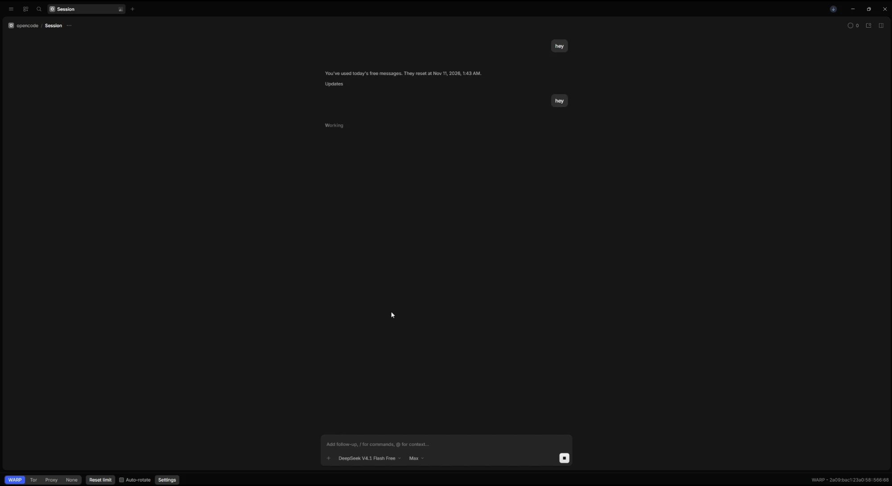
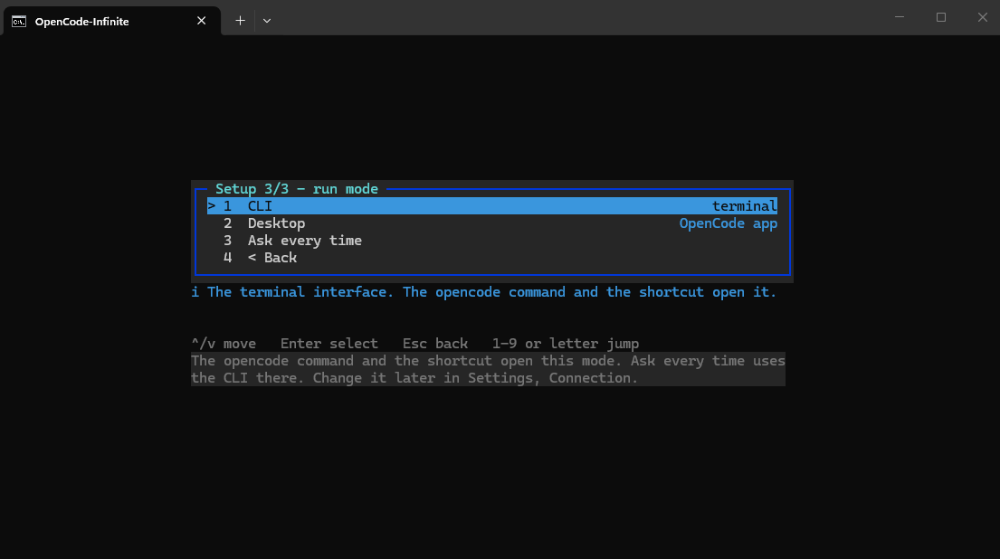
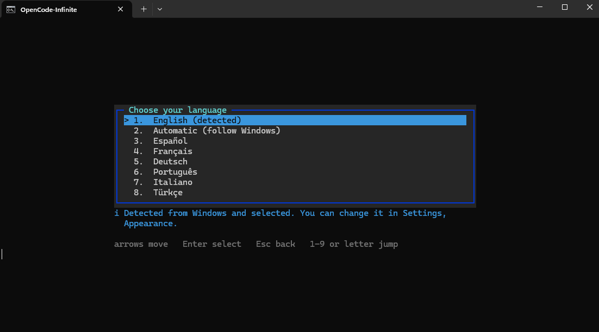

# OpenCode Infinite

Free-tier limits stop your [OpenCode](https://opencode.ai) chat. OpenCode
Infinite gets a new exit IP and carries on in the same chat.

## OpenCode Desktop Infinite (recommended on Windows)

**`OpenCode-Infinite-Desktop.exe`** is the OpenCode desktop app (v2.2.10) with the
tools built in: one installer, no launcher, no terminal. A bar at the bottom of
the window controls everything.



- **Many routes, only for OpenCode:** Auto (WARP when it works, otherwise direct) and None by default; with Advanced mode also Pool, WARP, Tor (bundled), Proxy, SOCKS5, Route64 (WireGuard), Mullvad and Windscribe. Pool hands every new connection to the next live exit, so one chat spreads across several IPs at once. Your browser and other apps stay direct, and the exit IP is shown in the bar.
- **Reset limit:** one click gets a new IP after "You've used today's free messages".
- **Auto-rotate:** when the free limit stops the chat, it changes the IP, tests it on a temporary session, and sends `continue` to your chat once an IP works (up to 10 tries).
- **Providers:** DeepAI is in the provider list next to the others.
- **Looks:** the Rainbow and pastel themes, one text color for any theme, and your own background image.
- **Updates:** the app's update button installs the new Infinite build from this repository, so the bar is kept.

Install it, open it, pick a route. Details, SHA-256 and the build steps are in [section 14](#14-opencode-desktop-infinite).

**Download:** [latest release](https://gitlab.com/jekooo/opencode-infinite/-/releases/permalink/latest)
(the desktop installer `OpenCode-Infinite-Desktop.exe`, the `.bat`, the `.sh` and `SHA256SUMS`).

## Prefer a terminal? The launcher

`OpenCode Infinite.bat` (Windows) and `opencode-infinite.sh` (Linux) start OpenCode through a different exit
IP and resume the same chat when a limit stops it. They also have WireGuard and
VPN Gate, which the desktop app does not.

## Which file to use

| File | Platform | What it is | Version |
|---|---|---|---|
| `OpenCode-Infinite-Desktop.exe` | Windows 10 / 11 (x64) | **The desktop app.** Installer of OpenCode (v2.2.20) with a bottom bar: Auto, None, Pool, WARP, Tor, Proxy, SOCKS5, Route64, Mullvad and Windscribe, Reset limit, Auto-rotate and three Settings tabs. Tor is bundled. See [section 14](#14-opencode-desktop-infinite) | 2.2.8 |
| `OpenCode Infinite.bat` | Windows 10 / 11 (x64, ARM64, x86 limited) | Full launcher: WARP, Tor (portable), WireGuard (through wireproxy), VPN Gate (OpenVPN), proxies, IP hunt, deep reset, updates, 7 languages; single-instance lock that checks PID, start time, executable and .bat path | 2.60.19 |
| `opencode-infinite.sh` | Linux (bash; Ubuntu 24.04 with apt; also dnf, pacman and zypper) | Full, including the desktop app, except the Windows-only items. See [Linux: what is different](#linux-what-is-different) | linux-0.4.7 |

The sections marked **Windows only** below are not on Linux.

- **Windows:** one file, no installer, no services. No UAC prompts: the optional WARP install and VPN Gate (OpenVPN) work only when you start the launcher as administrator (the helper that runs OpenVPN stays until the launcher closes or sits idle for 10 minutes). WireGuard never needs administrator.
- **Linux:** one script. No root needed for the launcher itself. WARP and Tor need their packages installed (section 1b).

### Windows: .bat or desktop?

- **Desktop installer (start here):** the OpenCode desktop app itself with its connections in a bottom bar: Auto and None, and with Advanced mode Pool, WARP, Tor, Proxy, SOCKS5, Route64, Mullvad and Windscribe. VPN Gate is not in it (section 14).
- **`.bat`:** the full launcher in a terminal, with every setting and the automatic resume of your chat.

Versions, what was checked and the open items are at the end, in [Versions and status](#versions-and-status).


---

## Contents

1. [Install](#1-install)
   - [1a. Windows](#1a-windows)
   - [1b. Linux](#1b-linux)
2. [First run](#2-first-run)
3. [Menus](#3-menus)
4. [Connection modes](#4-connection-modes)
5. [Automatic IP hunt](#5-automatic-ip-hunt)
6. [Renew session](#6-renew-session)
7. [Deep reset and restore](#7-deep-reset-and-restore)
8. [Settings](#8-settings)
9. [Languages and themes](#9-languages-and-themes)
10. [Keys and commands](#10-keys-and-commands)
11. [Updates](#11-updates)
12. [Files and folders](#12-files-and-folders)
13. [Troubleshooting](#13-troubleshooting)
14. [OpenCode Desktop (Infinite)](#14-opencode-desktop-infinite)

- [Linux: what is different](#linux-what-is-different)
- [Versions and status](#versions-and-status)

---

## 1. Install

### 1a. Windows

The Desktop folder is asked from Windows, so it works when Desktop lives in OneDrive.

**PowerShell or Windows Terminal (recommended):**

```powershell
[Net.ServicePointManager]::SecurityProtocol='Tls12'; $d=[Environment]::GetFolderPath('Desktop'); iwr https://gitlab.com/jekooo/opencode-infinite/-/releases/permalink/latest/downloads/OpenCode-Infinite.bat -UseBasicParsing -OutFile "$d\OpenCode Infinite.bat"; & "$d\OpenCode Infinite.bat"
```

**cmd** (`curl.exe` ships with Windows 10 1803 and later):

```cmd
powershell -NoProfile -Command "$d=[Environment]::GetFolderPath('Desktop'); [Net.ServicePointManager]::SecurityProtocol='Tls12'; iwr https://gitlab.com/jekooo/opencode-infinite/-/releases/permalink/latest/downloads/OpenCode-Infinite.bat -UseBasicParsing -OutFile (Join-Path $d 'OpenCode Infinite.bat'); & (Join-Path $d 'OpenCode Infinite.bat')"
```

### 1b. Linux

Download the script into your home folder and run it:

```bash
mkdir -p ~/.local/share/opencode-infinite && curl -fsSL https://gitlab.com/jekooo/opencode-infinite/-/releases/permalink/latest/downloads/opencode-infinite.sh -o ~/.local/share/opencode-infinite/opencode-infinite.sh && bash ~/.local/share/opencode-infinite/opencode-infinite.sh
```

The launcher installs what is missing by itself on first start. Each step runs on its own, so one failure does not stop the others. The only possible prompt is sudo's password, and only when you are not root. Output goes to `~/.config/opencode-infinite/install.log`. The table shows what gets installed:

| Needed for | apt (Debian, Ubuntu) | dnf (Fedora, RHEL) | pacman (Arch) | zypper (openSUSE) |
|---|---|---|---|---|
| WARP mode | Cloudflare's apt repo, then `cloudflare-warp` | Cloudflare's `.repo` file, then `cloudflare-warp` | Not in the official repos. Install `cloudflare-warp-bin` from the AUR by hand | Not automated. Install `cloudflare-warp` by hand |
| TOR mode | `tor`, `privoxy` | `tor`, `privoxy` | `tor`, `privoxy` | `tor`, `privoxy` |
| OpenCode (all modes) | `npm i -g opencode-ai` into `~/.local`. If npm is missing or fails, the official installer (`opencode.ai/install`) | same | same | same |
| Helpers | `curl`, `jq`, `nodejs`, `npm`, `xdg-user-dirs` | same names | same names | same names |

WARP's service (`warp-svc`) is enabled where systemd runs. Without systemd, start it by hand. Tor and privoxy: the launcher disables the privoxy system service it installed, so it does not block the Tor bridge on port 8118.

The script is one file. It copies itself into `~/.config/opencode-infinite/app/` at
setup, and the commands it creates run that copy.

---

## 2. First run

**Windows**

1. Double-click `OpenCode Infinite.bat`.
2. Pick a language (section 9). `Automatic` follows Windows.
3. Choose **Set up connection** on the home screen (it reads **Change connection** once configured). It asks for a connection method (section 4: WARP, TOR, PROXY, NONE, and on Windows also WIREGUARD and VPNGATE) and a run mode, then creates the `opencodeinf` and `opencode-auto` commands and the shortcuts (section 10). `opencode` is not changed: it stays the real OpenCode.
4. Choose **Launch OpenCode**, pick a folder and a connection, and start.

If WARP, Tor or OpenCode is missing, the launcher offers to install it. Nothing is installed without asking, and the launcher never asks for administrator rights: installs that need them run only from an administrator window.


**Linux**

1. Run the script (section 1b).
2. Choose **Connect with opencode** and pick WARP, TOR, PROXY or NONE. Setup creates the `opencodeinf` and `opencodeoc` commands in `~/.local/bin` and never replaces `opencode`, which stays the real OpenCode. It adds that folder to your `PATH` in `~/.bashrc` if needed.
3. Open a new terminal, then run `opencode` inside a project folder.

The screens and keys are the same as on Windows. Colors and the box drawing depend on your terminal.

---

## 3. Menus

### Home screen

| Option | What it does |
|---|---|
| Launch OpenCode | Picks a folder and a connection, then starts the CLI or the desktop app *(desktop app: Windows only)* |
| Set up connection (Windows) / Connect with opencode (Linux) | Guided setup. Creates the `opencodeinf` and `opencode-auto` commands (Linux: `opencodeinf` and `opencodeoc`) and the shortcuts. Shows `Configured` when done. Windows label changes to **Change connection** once configured |
| Renew session | Closes OpenCode, backs up `auth.json` (section 6), clears the saved tokens and gets a new IP (section 6) |
| Uninstall | Removes only what setup added and restores the settings it changed. Asks first |
| Settings | Every launcher option (section 8) |
| Support report | Writes one text file with versions, settings and the recent log, for help. Passwords and tokens are removed. IPs are masked by default |
| Exit | Closes the launcher |

### Main menu

Opened after **Launch OpenCode**. It shows the folder, egress, mode, WARP version and exit IP.

| Key | Option | What it does |
|---|---|---|
| `1` | New IP and start OpenCode | Gets a new IP or proxy, then opens OpenCode. Chats stay as they are |
| `2` | Continue | Same IP and chat: opens OpenCode as it was. Saved tokens are kept |
| `3` | Change IP (test) | Rotates the connection only, without opening OpenCode |
| `4` | Deep reset or restore chats | Submenu (section 7) |
| `5` | Mode (CLI or Desktop) | Switches between the terminal and the desktop app *(Windows only)* |
| `6` | Back | Returns to the home screen |
| `7` | Exit | Closes the launcher |

On Linux the main menu has these items: New IP and start OpenCode, Start OpenCode, Change IP (test), Chats (deep reset and restore), and Back.


---

## 4. Connection modes

The egress default is set during setup and in Settings, Connection (`OC_EGRESS_DEFAULT`). With `ASK` the launcher asks at each start; the choice is not saved.

| Mode | How it works |
|---|---|
| **WARP** | Cloudflare WARP in local proxy mode (MASQUE protocol, port 40000). Every rotation registers again, which gives a new exit IP. Offered when WARP is missing. If a step fails, WARP stops there; there is no WireGuard fallback |
| **TOR** | Tor with an HTTP bridge on `127.0.0.1:8118`. **Windows:** a portable Tor with a built-in bridge, no Privoxy needed. **Linux:** `tor` and `privoxy` from your system. A Tor that is already running (Tor Browser on port 9150, or 9050) is used as it is and never closed by the launcher |
| **PROXY** | Free HTTP proxies from a list. Settings > Proxy list offers ProxyScrape (default), proxifly, GeoNode (HTTP only, fastest first), monosans, TheSpeedX, or your own list (`PROXY_LIST_URL`: a URL or a local file). `PROXY_FIXED` (Settings > Proxy list > Your own proxy, `host:port`) replaces the list when it is set. Each pick tests untried proxies in random order (`PROXY_TRY_MAX` per pick, default 40 on Windows and 25 on Linux); dead ones are skipped, and the list is reused once all of it was tried. In PROXY mode, after `PROXY_ROT_MAX` burned proxies the launcher asks whether to switch the hunt to Tor |
| **NONE** | Direct connection, no proxy |
| **WIREGUARD** | **Windows only.** Your WireGuard `.conf` files from `WG_DIR` (default `...\opencode-infinite\wireguard`), run through [wireproxy](https://github.com/windtf/wireproxy), a local proxy that only OpenCode uses. Each switch takes the next file. Needs no WireGuard install and no administrator prompt |
| **VPNGATE** | **Windows only.** Public servers from [vpngate.net](https://www.vpngate.net) through the normal OpenVPN client (`openvpn.exe`). Installed with winget when it is missing. OpenVPN creates a system tunnel, but the launcher adds routes only for the IPs of `opencode.ai`, `models.opencode.ai` and `opentunnel.xyz` as they resolve on your PC at start (`route-nopull`). Everything else stays direct. Filter by `VPNGATE_COUNTRY`, `VPNGATE_MAX` servers tried per start. A server that fails is skipped for the session. It needs a window that is already administrator; the launcher never asks for it |

The proxy applies only to the OpenCode process. Your browser and other apps
stay direct. WIREGUARD makes no system tunnel. VPNGATE adds routes to the system
table for OpenCode's IPs only, so any other program that talks to those same IPs also uses the tunnel.
VPN Gate servers carry IPv4 only. The launcher also routes OpenCode's IPv6 addresses into the tunnel, where OpenVPN's `block-ipv6` drops them, so OpenCode falls back to IPv4 through the tunnel and never sends IPv6 outside it. OpenCode's Node processes also start with IPv4 first. Other programs' IPv6 traffic is not changed. The server configs are filtered before use: directives that run programs or touch local files are removed.

WIREGUARD uses the `.conf` files in `WG_DIR` through a local wireproxy. VPNGATE uses the public OpenVPN servers from vpngate.net. OpenCode's IPv4 traffic goes through the tunnel, other traffic stays direct, and the routes are removed on stop. The routes are set when the tunnel starts. If OpenCode's IPs change during a session, the status shows DOWN and the launcher reconnects, which may pick another server. The exit IP check goes through opencode.ai, so a request that leaves by the normal route is reported as a failure. Report problems in an issue.


**Run mode** is chosen the same way: **CLI** (terminal), **Desktop** (the OpenCode app), or **Ask every time**. On Linux it is the setting Settings > Connection > Run mode (CLI or DESKTOP, no Ask every time), and the quick start (`bash opencode-infinite.sh --run`) always runs the CLI.



**32-bit Windows (x86):** WARP and the desktop app are not available. OpenCode runs
through npm with a 32-bit Node.js.

---

## 5. Automatic IP hunt

When a chat hits a limit, the launcher hunts for a new IP.

- **Target:** `TARGET_COUNTRY` (for example `DE`) and/or `TARGET_PREFIX` (for example `104.28.`). Both empty means any new IP.
- **Caps:** `TARGET_TRIES` attempts, `TARGET_MINUTES` minutes, and `TARGET_INTERVAL` seconds between attempts. The hunt is the same on both systems.
- Each attempt prints its number, the IP, the country and whether it matches. The hunt ends with a summary: target reached, or which cap stopped it.
- `Esc` or `Q` during the wait stops the hunt and returns to the menu.
- With `AUTO_ROTATE` off, the menu decides. The `R` key at the closed prompt always rotates.
- **IP pool (`.bat`, `POOL_ENABLE` on by default).** While **Settings** is open, the launcher tests IPs for the PROXY, VPNGATE and WIREGUARD modes in the background and keeps up to `POOL_MAX` per mode, one search every `POOL_INTERVAL` seconds. A rotation takes a saved IP first; if that one fails, it searches as before. The search stops when you leave Settings. VPN Gate is tested only when its helper already runs, so the pool never asks for administrator. The proxy list is downloaded again at most every 30 minutes. Set `POOL_ENABLE` to 0 to turn it off.

---

## 6. Renew session

Use **Renew session** when the free limit is reached or the login has expired. It:

1. closes every running OpenCode process;
2. backs up `auth.json` to `%LOCALAPPDATA%\opencode-infinite\backup\auth\<date-time>\`;
3. clears the saved tokens;
4. gets a new IP, WARP registration, Tor circuit or proxy.

Between renewals the launcher keeps a copy of `auth.json` in its state folder (`auth_snapshot`) and puts it back at the next start if the file has disappeared. A reset removes that copy, so the tokens stay gone. Side effect: if you log out inside OpenCode, the old login comes back at the next start; use Renew session to be sure the tokens are cleared.

The backup stays out of the Desktop because the Desktop often syncs to OneDrive, and `auth.json` holds your API keys in plain text. On Linux the backup goes to the launcher's state folder, never the Desktop.


---

## 7. Deep reset and restore

Option `4` in the main menu opens this submenu. It is the only option that moves your chats, and it asks first.

**Deep reset**

1. Stops OpenCode.
2. Moves the database (`opencode.db` with its `-wal` and `-shm` files) and the `storage` folder to `Desktop\opencode_chats_archiviate\<date-time>\`. Each reset gets its own folder. Nothing is deleted.
3. Clears tokens and the cache.
4. Starts a fresh session.

**Restore chats** lists the archived folders, newest first. Pick one and the launcher:

1. stops OpenCode;
2. moves the chats in place now to `Desktop\opencode_chats_before_restore\<random>\`;
3. copies the database and storage back from the chosen folder;
4. starts OpenCode.

Login tokens are not restored. Sign in again if OpenCode asks.

---

## 8. Settings

Open **Settings** from the home screen. Every change is saved at once to
`config.json` on Windows, or to `config.env` on Linux (section 12). On Linux, `config.json` is updated too when it exists.


Settings are grouped as **Connection, Tor, Proxy list, Rotation, Watcher, Probe, Updates, Appearance, Shortcuts, Logs** on both systems, and **Support** (export, import, reset, shortcut, updates, report). Windows also has **Egress** (WireGuard and VPN Gate). Enter toggles a yes/no value, opens a list for a choice (the current value is marked), and opens a prompt for a number or text.

Setting names are the same on Windows (`config.json`) and Linux (`config.env`). The defaults:

| Setting | Default | Meaning | Platform |
|---|---|---|---|
| `OC_EGRESS_DEFAULT` | `ASK` | Route for OpenCode: `ASK` (picked at each start), `WARP`, `TOR`, `PROXY` or `NONE` | both |
| `PROXY_PORT` | `40000` | WARP local proxy port | both |
| `WARP_WAIT` | `20` | Seconds to wait for WARP to connect (Windows: `6`) | both |
| `WARP_CALL_TIMEOUT` | `15` | Seconds one `warp-cli` call may take | both |
| `TOR_SOCKS_PORT` / `TOR_HTTP_PORT` | `9050` / `8118` | Tor SOCKS port and the HTTP bridge port | both |
| `TOR_AUTO_INSTALL` | `1` | Install Tor when missing (Windows: portable bundle; Linux: package manager) | both |
| `TOR_BOOTSTRAP_WAIT` | `120` | Seconds to wait for Tor to connect | both |
| `PROXY_LIST_URL` | ProxyScrape free HTTP list | The list used by PROXY mode. Settings also offers proxifly, GeoNode, monosans and TheSpeedX; or a URL or a local file, any format. `ip:port` entries are picked out | both |
| `PROXY_LIST_MIN_BYTES` | `20` | A downloaded list smaller than this is rejected (`0` = off) | both |
| `PROXY_TRY_MAX` | `40` (Linux: `25`) | Untried proxies tested per pick; tested ones are skipped until the list is used up | both |
| `PROXY_PROBE_TIMEOUT` | `8` | Seconds one proxy test may take | both |
| `PROXY_ROT_MAX` | `10` | Burned proxies in one hunt before PROXY mode offers Tor | both |
| `PROXY_API_CHECK` / `PROXY_API_CHECK_URL` | `0` / `https://api.opencode.ai/` | Also require the proxy to reach the OpenCode API host | both |
| `AUTO_ROTATE` | `1` | Rotate and resume after a limit by itself (`0` = the menu decides) | both |
| `ROTATE_TRIES_MAX` | `4` | Rotation attempts when the route is not up (1-20) | both |
| `ROTATE_COOLDOWN` | `10` | Seconds between rotation attempts | both |
| `IP_FIND_MAX` | `0` | Burned IPs a hunt may reject (`0` = no limit) | both |
| `TARGET_COUNTRY` / `TARGET_PREFIX` | empty | Country (e.g. `DE`) and IP start (e.g. `104.28.`) to hunt for | both |
| `TARGET_TRIES` / `TARGET_MINUTES` / `TARGET_INTERVAL` | `5` / `15` / `15` | Attempts, minutes and seconds between attempts of one hunt | both |
| `POOL_ENABLE` / `POOL_MAX` / `POOL_INTERVAL` | `1` / `5` / `60` | IP pool: on or off, saved IPs per mode (1-50), seconds between searches (5-3600). Section 5 | Windows only |
| `ON_CLOSE` | `ask` | After OpenCode closes: `ask` (R new IP and resume, M menu, Q quit) or `quit` | both |
| `WATCH` | `0` | Watch the OpenCode log for limit errors and rotate on a fatal error. Off by default since 2.60.3, so the launcher does not keep sending "continue" into a used-up IP | both |
| `RESUME_MSG` | `continue` | Message sent when a chat is resumed | both |
| `RESUME_AUTO` | `1` | The resume approves tool permissions (`opencode run --auto`) | both |
| `RESUME_TIMEOUT` | `90` | Seconds before a stuck resume is stopped and the launcher rotates | both |
| `PROBE` / `PROBE_MODEL` | `0` / empty (= the chat's model) | Probe each new IP with one cheap message, and the model it uses. Off by default: each probe uses the free quota and leaves a session. The probe creates its own session (titled `ocinf-probe`) and deletes it afterwards, so no fixed session id is needed | both |
| `PROBE_BROKEN_MAX` | `3` | Non-limit probe failures before the hunt stops | both |
| `UPDATE_CHECK` | `1` | Check for a newer launcher at start (section 11) | both |
| `UPDATE_ASK` | `ask` | `ask` offers updates at start, `never` turns checks off | both |
| `OC_API_BASE` | `https://opencode.ai/update/api/latest` | Where the newest OpenCode version is read from (Linux: npm is the fallback) | both |
| `OCUI_THEME` | `ocean` | Colors: `ocean`, `forest`, `sunset`, `mono`, `rainbow`, plus the ones in `themes/themes.txt` (section 9) | both |
| `OCUI_COLOR` | `auto` | `auto` follows the terminal and `NO_COLOR`; `on` or `off` forces it | both |
| `OCUI_ICONS` | `auto` | Borders: `auto`, `unicode`, `emoji` (same as unicode on Linux), `ascii` | both |
| `OCUI_LANG` | `auto` | Language (section 9) | both |
| `KEY_ROTATE` / `KEY_MENU` / `KEY_QUIT` | `R` / `M` / `Q` | Letter keys for the closed-OpenCode prompt | both |
| `LOG_ENABLED` / `LOG_MAX_KB` | `1` / `1024` | Launcher log on or off, and its size limit | both |
| `LOG_MASK_IP` | `1` | Mask public IPs in the support report | both |
| `OC_MODE_DEFAULT`, `OC_APP` | | CLI or Desktop run mode, path of the Desktop app | Windows only |
| `WG_DIR` | empty | Folder of WireGuard `.conf` files (empty = `...\opencode-infinite\wireguard`) | Windows only |
| `VPN_TIMEOUT` | `45` | Seconds one WireGuard or VPN Gate connection may take to answer | Windows only |
| `VPNGATE_COUNTRY` / `VPNGATE_MAX` | empty / `8` | VPN Gate country (two letters, empty = any) and servers tried per start | Windows only |
| `MENU_DEFAULT` | `ask` | Option that runs at once when the menu would show: `ask`, `1` (new IP), `2` (continue, tokens kept) or `3` (change IP) | Windows only |
| `MULTI_INSTANCE` | `0` | `1` lets a second launcher window run with its own copy of the settings (in `instances\<id>`) | Windows only |
| `REUSE_EMPTY` | `1` | Continue the empty chat of the folder instead of creating another | Windows only |
| `CHAT_SNAPSHOT` | `1` | Print the last messages of the chat when OpenCode closes for a renewal | Windows only |
| `TYPE_AHEAD` | `1` | Text typed during a renewal is sent as the first message of the resume | Windows only |
| `RESUME_MODE` / `RESUME_TEXT` | `continue` / empty | What the resume sends: `continue`, `last` (your last message again) or `custom` (`RESUME_TEXT`) | Windows only |
| `OC_MODEL` | empty | Model for the resume (`-m`), for example `opencode/deepseek-v4.1-flash-free` | Windows only |
| `LIMIT_ROT_MAX` / `LIMIT_ACTION` / `LIMIT_MODEL` | `3` / `rotate` / empty | Limits in a row before the launcher stops (`0` = never stop). Then `rotate` (new IP), `provider` (switch to `LIMIT_MODEL` once) or `ask` | Windows only |
| `WHERE_TIMEOUT` | `5` | Seconds a Windows `where` lookup may take | Windows only |
| `OCUI_FONT` / `OCUI_FONT_SIZE` | empty / `16` | Terminal font and size (Windows console) | Windows only |

---

## 9. Languages and themes

Pick the language in **Settings, Appearance, Language**. The list has
`Automatic` (follows Windows), English, Español, Français, Deutsch, Português,
Italiano, Türkçe and Русский.



Each language is a JSON file in the `langs` folder of this repository. The
launcher downloads only the language you pick, when you pick it. It stays in
`%LOCALAPPDATA%\opencode-infinite\lang\` and is not downloaded again until you pick
it again. Without a connection the menus stay in English until a download works.
Logs and the support report stay in English.

On Linux the same languages are used. The file goes to `~/.config/opencode-infinite/langs/`,
and `Automatic` follows `LANG`.

### Color themes

The built-in themes are `ocean` (the default), `forest`, `sunset`, `mono` and `rainbow`. More themes are kept in
`themes/themes.txt` of this repository, so the launcher itself stays small. Pick one in **Settings, Appearance,
Color theme**; the list shows the extra ones after the built-in five.

The launcher downloads that file when it is missing or when its version changes, and keeps a copy in the state folder
(`themes\themes.txt`, or `~/.config/opencode-infinite/themes/` on Linux). Without a connection the built-in five are
used, and the copy already there keeps working. A line that does not fit the format is skipped; the format is one
theme per line:

```
name|title|accent|border|selected|rainbow
ice|1;97|37|36|30;47|0
```

`name` is 2 to 20 letters, digits, `_` or `-`, and is not one of the built-in names. The four colors are terminal color
codes (digits and `;` only), and `rainbow` is `1` for the moving colors or `0` for fixed ones. A theme file is data:
the launcher never runs anything from it.

---

## 10. Keys and commands

| Key | Action |
|---|---|
| Arrows | Move through a menu |
| `Enter` | Select |
| `Esc` | Back, in every menu and prompt |
| `1`-`9` | Select a numbered option directly |
| `Ctrl+C` | Quit the launcher. **Windows:** it stops the processes it started and leaves the window open. **Linux:** it quits the launcher |
| `R`, `M`, `Q` | At the closed-OpenCode prompt: new IP and resume, menu, quit. The letters are editable in Settings, Shortcuts |

The commands created by **Set up connection** (Windows) or **Connect with opencode** (Linux) work in any terminal:

| Command | What it does |
|---|---|
| `opencode` | Starts OpenCode as it was before the launcher, with no connection. The launcher does not change it |
| `opencodeinf` | Opens the launcher menu. Start OpenCode from there to use the saved connection (the shortcut opens it too) |
| `opencode-auto` | Windows only. Starts the current folder with the last working connection and no menus (see [Automatic start](#automatic-start-opencodeinf---auto)). Created by Set up connection or by Install commands |
| `opencodeoc` | Linux only. The same as `opencode`, with no connection. Kept as a fallback name |

**Install or remove the commands on their own.** They do not depend on Set up connection:

- **Windows (`.bat`):** Settings, Launch group. **Install commands** writes `opencodeinf` and `opencode-auto` and puts their folder on your PATH. **Remove commands** deletes those two; the PATH entry is removed only when the folder is empty. The `.exe` has the same two options under More.
- **Linux (`.sh`):** main menu. **Install commands** writes `opencodeinf` and `opencodeoc` to `~/.local/bin` and adds that folder to PATH in `~/.bashrc`. **Remove commands** deletes those two; the `~/.bashrc` line is removed only when the folder is empty. Install needs the real `opencode` to be installed.

Neither option changes the plain `opencode` command, the settings or the desktop shortcut.

**Windows:** to start the launcher in a folder, drag the folder onto the `.bat`, or run
`OpenCode Infinite.bat "D:\work\project"`. UNC paths work too.
`OpenCode Infinite.bat --run` does a quick start with the saved connection.

**Windows automatic start:** see [Automatic start](#automatic-start-opencodeinf---auto) below.

**Linux:** `opencode` starts OpenCode in the current folder with no connection. `opencodeinf` opens the menu, which starts it through the saved connection. The script can also be run directly: `bash opencode-infinite.sh --run`.

### Automatic start: `opencodeinf --auto`

Windows only. `opencodeinf --auto` and `opencode-auto` do the same thing: they start OpenCode in the current folder without any menu. (`opencode --auto` is not a launcher command: `opencode` always starts the plain OpenCode.)

1. **Folder:** the folder the terminal is in.
2. **Connection:** the method that worked at the last start, saved in `last_method.txt`. With no saved method it is WARP. A saved NONE, WIREGUARD or VPNGATE is treated as WARP.
3. **Connecting:** the launcher tries that method. If it does not connect, it moves to the next one in this order: WARP, TOR, PROXY, then WARP again. Automatic start never uses VPN Gate or WireGuard and never asks for administrator. Every third failure in a row waits 5 seconds first.
   - **WARP:** uses the WARP proxy if it already answers. Otherwise it sets WARP to proxy mode on `PROXY_PORT` and connects. There is no registration and no installer step.
   - **TOR:** uses the Tor the launcher starts, or a Tor that is already running, through its HTTP bridge on `TOR_HTTP_PORT`.
   - **PROXY:** keeps the last working proxy while it answers. Otherwise it tries proxies from the list until one works, up to `PROXY_TRY_MAX` per pick.
4. **Start:** OpenCode opens in the folder through the connection that works.
5. **Limits and closing:** when OpenCode reaches a usage limit (a limit line written to the log during this run), the launcher gets a new IP on the same method. A rate limit does the same. A plain close, with no limit line from this run, ends the launcher and keeps the IP. The hunt is limited by `TARGET_TRIES` and `TARGET_MINUTES`. If the new IP fails twice in a row, it moves to the next method in the order above. Automatic restarts are limited to 3 in 10 minutes.
6. **Same chat:** if the connection changes while OpenCode was open, the launcher sends a message after the restart so the same chat continues.

**What you see:** short lines in the console, such as "Connecting...", "Trying TOR..." and "Changing IP...". The details go to `launcher.log` in the state folder (section 12).

**No time limit:** the whole start has no fixed time limit. A Tor download or a stalled tunnel can take longer than 30 seconds.

---

## 11. Updates

**Windows.** With `UPDATE_CHECK=1`, every start checks three things:

- **A newer launcher** in the latest [release](https://gitlab.com/jekooo/opencode-infinite/-/releases). The launcher reads the release tag, downloads the file and `SHA256SUMS` at that tag, and keeps the file only when its SHA-256 matches and its header carries the tag's version. It never takes a file from `main` that has no release. It asks `[Y/N]`. On `Y`, it keeps a backup of the current file, replaces it and restarts. A failed checksum is shown and nothing changes.
- **A newer OpenCode** from opencode.ai (official release data, SHA-256 checked). It asks `[Y/N]`, closes every OpenCode process, then installs. It uses the same channel as the running command: npm or the standalone build.
- **A newer OpenCode Desktop** (Desktop mode only). Same flow, with the silent installer.

No network, or an unreadable version, changes nothing.

**Linux.** On start the launcher checks the latest release for a newer copy of itself, with the same SHA-256 check (it backs up the old file and asks first) and for a newer OpenCode through npm (it asks first). **Check for updates** in Settings > Support runs the same check now.

**Publishing a version** (maintainers):

1. Raise the version in the launcher header (`REM  OpenCode launcher  (vX.Y)` or `(vX.Y.Z)`) and, for Linux, `VERSION=` in the script.
2. Write the checksums and commit them with the files: `sha256sum "OpenCode Infinite.bat" opencode-infinite.sh > SHA256SUMS`.
3. Push a tag with the same version: `git tag vX.Y && git push origin main vX.Y` (or `vX.Y.Z`; the launcher accepts both, and the header must match the tag exactly)
4. Create the release for that tag in GitLab (**Deploy > Releases > New release**) and attach `OpenCode-Infinite.bat`, `opencode-infinite.sh` and `SHA256SUMS` (the launcher downloads the `.bat` by that name). The desktop installer `OpenCode-Infinite-Desktop.exe` (about 295 MB) is too large for a release attachment: upload it to the project's generic package registry and add it to the release as a link. Its SHA-256 goes in the release notes, not in `SHA256SUMS`, which the launcher reads.
The launcher only reads the latest release's tag and checks the file against `SHA256SUMS` at that tag, so a commit on `main` without a release reaches nobody. `.gitattributes` keeps the `.bat` files with CRLF in the repository, so the downloaded bytes are the ones that were hashed.

---

## 12. Files and folders

**Windows**

| Path | Purpose |
|---|---|
| `%USERPROFILE%\.local\share\opencode\` | OpenCode data: chats and database. Owned by OpenCode |
| `%LOCALAPPDATA%\opencode-infinite\` | Launcher state folder |
| `...\opencode-infinite\app\` | The launcher copy that `opencodeinf` runs |
| `...\opencode-infinite\config.json` | Your settings |
| `...\opencode-infinite\lang\` | Language files you picked, and `messages.txt` for the batch messages |
| `...\opencode-infinite\themes\` | `themes.txt`: the extra color themes, downloaded from the repository |
| `...\opencode-infinite\launcher.log` | Launcher log |
| `...\opencode-infinite\reports\` | Support reports |
| `...\opencode-infinite\tor\` | Portable Tor (TOR mode only) |
| `...\opencode-infinite\backup\auth\` | `auth.json` backups made by Renew session and the resets |
| `Desktop\opencode_chats_archiviate\` | Chats archived by a deep reset |
| `Desktop\opencode_chats_before_restore\` | Chats moved aside by a restore |

**Linux**

| Path | Purpose |
|---|---|
| `~/.local/share/opencode/` | OpenCode data: chats, database and `auth.json`. Owned by OpenCode |
| `~/.config/opencode-infinite/` | Launcher state folder (`OCI_STATE` overrides it) |
| `~/.config/opencode-infinite/config.env` | Your settings, one `KEY=value` per line |
| `~/.config/opencode-infinite/app/` | The launcher copy that the commands run |
| `~/.config/opencode-infinite/launcher.log` | Launcher log |
| `~/.config/opencode-infinite/reports/` | Support reports |
| `~/.config/opencode-infinite/tor/`, `tor.log`, `privoxy.conf` | Tor data and the HTTP bridge config (TOR mode only) |
| `~/.config/opencode-infinite/wcli.log` | `warp-cli` output, for WARP problems |
| `~/.local/bin/opencodeinf`, `opencodeoc` | The commands created by setup. `opencode` is the real OpenCode and is not touched |

---

## 13. Troubleshooting

| Symptom | What to do |
|---|---|
| The launcher shows old text or an old version | **Windows:** accept the update prompt on the next start. **Linux:** download the script again (section 1b) |
| `Terminate batch job (Y/N)?` | *Windows.* You pressed `Ctrl+C` inside the launcher. Answer `N` to keep it running |
| WARP rotation keeps failing | Use **Renew session**. The daemon's own error text is in `wcli.log` in the state folder |
| TOR says it is not up after 120 s | Raise `TOR_BOOTSTRAP_WAIT`. **Windows:** the last `tor.log` lines are printed with the message. **Linux:** read `~/.config/opencode-infinite/tor.log` |
| TOR is up but the IP is not Tor | **Linux:** the port on `TOR_HTTP_PORT` is served by a Privoxy that does not forward to Tor. Set another `TOR_HTTP_PORT` in `config.env`, or set `forward-socks5t / 127.0.0.1:9050 .` in your Privoxy config |
| A custom proxy list is ignored | One proxy per line, as `ip:port` or `http://ip:port`. For a short list set `PROXY_LIST_MIN_BYTES=0` (Windows) |
| `Another OpenCode launcher seems to be running` | *Windows.* A lock is left over from a `Ctrl+C`. `Y` is safe |
| `opencode is not set up` on Linux | Run **Connect with opencode** first. The launcher reads the real OpenCode path from `config.env` |
| `opencode was not found` on Linux | Install it: `npm i -g opencode-ai`, then run Connect again |
| OpenCode does not open | Run `opencodeoc` to reach OpenCode, then create a support report from the home screen |
| `opencode` fails or shows the launcher's message after v2.52 | Update to v2.53 and start `opencodeinf` once. The launcher puts the real `opencode` back at each start |
| The update says a new version is available, but the file cannot be found | Known issue, not reproduced yet. Run the install command in section 1a: it puts a fresh copy on the Desktop. Then create a support report and attach it to an issue |
| The font does not change | *Windows.* Reopen the tab. Windows Terminal keeps its font in its own `settings.json`. VS Code keeps it in `terminal.integrated.fontFamily` |

For anything else, create a **Support report** from the home screen and attach
the file to an issue.

---

## 14. OpenCode Desktop (Infinite)

`OpenCode-Infinite-Desktop.exe` is the OpenCode desktop app (v2.2.20) with the launcher's tools built in, so you pick the exit IP from the app itself. No launcher is needed.


**Get it.** It is attached to the [latest release](https://gitlab.com/jekooo/opencode-infinite/-/releases/permalink/latest) as a link, because it is too big (about 268 MiB, 281 MB) for a release file. Direct link: `https://gitlab.com/jekooo/opencode-infinite/-/releases/permalink/latest/downloads/OpenCode-Infinite-Desktop.exe`. Check it against the SHA-256 below before you run it.

SHA-256: `c7e2526fbedf0b31790525ccb15c140bfcec033266179eb241d0cc1f5080ec00`

**Connections.** The bar starts with **Auto** and **None**. Turn on **Settings > Basic > Advanced mode** to see every connection and the Advanced tab.

| Connection | What it is | Needs |
|---|---|---|
| **Auto** | WARP when it works, otherwise a direct connection | Nothing; it never installs anything |
| **None** | Direct connection (no IP to change) | Nothing |
| **Pool** | Every live route at once: your proxies and SOCKS5 servers, WARP and Tor when they are up. Each new connection leaves by the next route and a route that refuses is skipped, so a chat spreads across several IPs instead of one. An idle tunnel is closed after two minutes and the next request goes out on another route | Your proxy or SOCKS5 list, WARP, or Tor: whatever is available. Works with one of them and gets better with more |
| **WARP** | Cloudflare WARP as the route for OpenCode | [Cloudflare WARP](https://one.one.one.one) (`warp-cli`). If it is missing the app offers to install it from Cloudflare (publisher checked; Windows asks for administrator) |
| **Tor** | A new Tor circuit for each new IP | Nothing: a portable Tor is bundled |
| **Proxy** | Your own proxy or a whole list, or a free list | Nothing |
| **SOCKS5** | The SOCKS5 servers you list in Settings > Advanced | The servers (`host:port`, `socks5://host:port` or with `user:password@`) |
| **Route64** | A WireGuard tunnel from route64 | WireGuard (the app offers to install it) and the `.conf` you download from manager.route64.org, imported in Settings > Advanced > route64 tunnel |
| **Mullvad** / **Windscribe** | Switches the server of the VPN client you already use | The client installed and logged in. The app only changes the server and never stores your account |

**Own the exits.** [`tools/egress-rotator`](tools/egress-rotator) is a small CONNECT proxy for a Linux VPS with a routed IPv6 prefix. It source-binds a different address inside the prefix on every connection, so a single entry in **Settings > Advanced > Proxies** gives Pool thousands of owned IPs instead of shared free proxies. Setup, systemd unit and the IPv4 variant are in its README.

**Automatic connection.** The first time the app opens, a **Connection** window finds what works and sets it up on its own; it does not come back. While the app runs, a watcher checks the connection every 20 s and, if the proxy of the chosen mode stops answering, repairs it (at most every two minutes; a direct connection is left alone). If the proxy of the saved mode is down when the app starts, OpenCode connects directly instead of failing every request with `ECONNREFUSED`.

**Your own gateway (OmniRoute).** In **Providers**, pick **OmniRoute**, enter the API address of your OmniRoute (or any OpenAI-compatible server), for example `https://your-server/v1`, and its key. The models are the ones your server lists at `/models`; they load when the app starts and when you connect.

VPN Gate is only in the `.bat` and the `.sh`.

**The bottom bar** (the strip at the bottom of the screenshot):

| Control | What it does |
|---|---|
| **Connection** | Route for OpenCode (the table above). Only OpenCode goes through it; your browser and other apps stay direct. The exit IP is shown on the right |
| **Fix connection** | Tests what works on this computer and puts the best connection in place: WARP, your own SOCKS5 and proxy lists, Tor, then direct. It never uses Route64, Mullvad or Windscribe on its own |
| **Status** | What each connection needs and whether this computer has it, with **Use**, **Install** (WARP, with your confirmation) and **Settings** buttons |
| **Reset limit** | Gets a new IP after "You've used today's free messages" and lets you send again |
| **Auto-rotate** | On by default. When the free usage limit stops the chat, the chat waits and resends by itself while the app changes the IP under it (the IP that hit the limit is remembered as used), so no `continue` is needed: about 4 s per IP with WARP. Works with Pool, WARP, Proxy, Tor, SOCKS5, Mullvad and Windscribe; Route64 has a fixed IP. After 10 resends it falls back to trying IPs on a temporary session and sending one `continue` (up to 10 IPs by default, set in **Settings > Basic > Auto-rotate attempts**). It also rotates when the connection stays down for about 30 s |
| **Settings** | Three tabs, below |

**Settings.**

| Tab | What is in it |
|---|---|
| **Basic** | **Advanced mode**; **Exit country** (two letters, for proxies from that country); **Speed** (**Fast mode**, off by default: it sends `continue` as soon as the IP changes, without checking it first, about 3 to 4 s instead of about 7 s, and if that IP is already limited the chat rotates again); **Auto-rotate attempts** (how many IPs one rotation tries, 1 to 50, default 10); **Recent connection changes** (the last ten, kept only on this computer); **Reset** |
| **Advanced** (with Advanced mode) | **Proxies** (one or a list, from text, a file or a URL, with an optional change-IP URL); **SOCKS5 servers**; **Failover chain** (the modes Auto-rotate falls back to, in order, when the chosen one cannot get a fresh IP, for example `TOR,PROXY`); **route64 tunnel**; **VPN locations** for Mullvad or Windscribe, separated by commas |
| **Personalization** | **Theme** (Rainbow and the pastel ones first), **Rainbow moves**, **Font**, **Size**, **Motion**, **Background** image, **Settings window** opacity (how solid this window is) and **Text color** |

The `opencode-infinite` start screen replaces the normal one.

**Look (Settings > Personalization).** Pick **Rainbow**, a theme whose accent colors flow like the `.bat`'s rainbow while the background and the text drift slowly through the colors (a still palette if Windows is set to reduce motion). **Text color** sets one color for all the text on any theme; with it, Rainbow keeps moving only the background and the accents. **Background image > Choose image…** puts your own picture behind the window; it is shrunk to 1920 px and kept in the app only, **Remove** takes it away, and **Interface opacity** sets how much of the picture shows through.

**Updates.** From desktop 2.2.6 the app's update button reads `latest.yml` from the latest release of this repository and installs `OpenCode-Infinite-Desktop.exe` from there, so an update keeps the Infinite bar. Older installs still update from opencode.ai, which would replace them with the plain OpenCode: install 2.2.6 by hand once.

**Build.** The full source is in [`opencode-app/`](opencode-app/BUILD.md): clone the repository, `bun install`, build the CLI, add the portable Tor bundle and pack. The steps are in `BUILD.md`.

**Not in the desktop app:** VPN Gate, the `.bat`'s own WireGuard setup (the desktop has Route64 instead) and the `.bat`'s automatic chat resume by settings (`RESUME_MODE`). Use the `.bat` for those.

## Linux: what is different

- **Same:** the menus and keys, the four egress modes, rotation, the IP hunt, the
  probe, the watcher that stops OpenCode at a limit line and resumes the chat, Renew
  session, deep reset and restore, Settings, the update check, the shortcut file
  (`.desktop`), the languages, the support report, and the three commands.
- **Not on Linux:** the portable Tor bundle (Linux uses your `tor` and `privoxy`), the
  `where` lookup timeout, and the terminal font settings (the terminal owns its font).
- **Desktop app (Run mode DESKTOP):** the launcher starts the path in `OC_APP` (the
  setting, or the environment variable when the setting is empty), else
  `/opt/OpenCode/ai.opencode.desktop` (the `.deb` from the OpenCode releases), else
  `ai.opencode.desktop` on the PATH. After each new IP it closes the copy it started,
  never one opened by hand, and starts it again. The chat is not resumed with a
  message, as on Windows. The probe still uses the CLI, so opencode must be installed
  too.
- **Different:** the launcher installs WARP, Tor, privoxy and opencode with your
  package manager (apt, dnf, pacman or zypper). On pacman, WARP is an AUR package
  and is installed by hand.
- **Rotation in TOR mode:** the launcher restarts only the Tor it started. If you
  use a Tor that is already running, the IP may not change between tries.
- **Terminal:** colors and box drawing need a UTF-8 locale with 256 or true color.
  `NO_COLOR=1` turns the colors off.

## Versions and status

**Latest version:** launcher 2.60.19 (`.bat`), Linux script 0.4.7.
**OpenCode Desktop (Infinite build):** 2.2.20, installer `OpenCode-Infinite-Desktop.exe` ([section 14](#14-opencode-desktop-infinite)).
**Latest published release:** 2.60.19 (2026-11-19). **Previous:** 2.60.18 (2026-11-17).

### 2.60.19

- **DeepAI stops being slow (desktop 2.2.20):** the DeepAI Code lane routes by client. It served the official app in 0.2-4 s and queued everything else for 20-30 s, and it now answers the fork's own `User-Agent` with a content filter. The provider sends the user agent the official client sends and lane 7 instead of the retired 6, so a turn with the full 72k guide went from 25-36 s to 2-8 s and the mid-answer cuts are gone. The first-output watchdog now waits 35 s instead of 4 s (measured prefill on that lane peaks at 32 s), a filter that lands mid-answer is retried into a fresh message when no tool call opened, and a silent lane gets two short retries instead of five long ones.
- **One database for the desktop:** the CLI is built for its own channel and opened an empty channel database, hiding the conversations and the DeepAI credential stored in `opencode.db`. The service now sets `OPENCODE_DISABLE_CHANNEL_DB`.
- Launcher and Linux script: unchanged, only the `.bat` version number moves.
- Content filter rows: while an attempt is being retried the timeline shows the retry, not the failure it superseded.

### 2.60.18

- **Your own proxies (desktop 2.2.19):** proxy and SOCKS5 lists now take the `host:port:user:password` form that providers such as Webshare hand out. When the saved proxy does not answer at start, the app picks another one from the list instead of connecting directly with your real IP. A list of one rotating gateway can be rotated (2.2.18 got stuck), the bar shows the real exit IP instead of the gateway's name, and entries that share one host name with different logins count as different proxies. With a list of your own (Proxy or SOCKS5), a proxy that stops answering is replaced by the next one even with Auto-rotate off. Your own paid proxies get 8 seconds to answer the check instead of 2.
- Launcher and Linux script: unchanged, only the `.bat` version number moves.

### 2.60.17

- **Dictation sends and closes the panel (desktop 2.2.18):** Win+H keeps the dictated words open (not committed) while its panel is up, so 2.2.17 waited forever and never sent. Now, once you stop talking for a moment, the app leaves the message box: Windows commits the words and closes the voice typing panel, the message is sent and the caret comes back. The panel itself is drawn by Windows and cannot be hidden while you talk.
- Launcher and Linux script: unchanged, only the `.bat` version number moves.

### 2.60.16

- **Dictation through Win+H (desktop 2.2.17):** the microphone next to Send now opens Windows voice typing (Win+H) in the message box and sends the text once you stop talking for a moment. Typing a key yourself, or clicking the microphone again, cancels the send. 2.2.16 ran its own speech recognizer, which heard nothing under Remote Desktop even where Win+H worked. The language choice is gone: Win+H uses its own.
- Launcher and Linux script: unchanged, only the `.bat` version number moves.

### 2.60.15

- **Voice dictation (desktop 2.2.16):** Settings > Basic > Voice dictation adds a microphone next to Send. Click it and talk: when you stop, it types what Windows heard and sends it. Click it again while it listens to stop without sending. It uses Windows' own speech service (the one behind Win+H), so it needs **Online speech recognition** turned on in Windows Settings > Privacy & security > Speech; the app says so if it is off. If Windows has more than one speech language, you pick it in the same card.
- Launcher and Linux script: unchanged, only the `.bat` version number moves.

### 2.60.14

- **DeepAI blocks shown as blocks (desktop 2.2.15):** DeepAI ends a blocked answer with `finish_reason: "content-filter"` (with a hyphen). OpenCode read it as a cut stream, sent a hidden "the previous response was interrupted, continue" and the model answered with nonsense, sometimes several times in a row. Now the chat stops once with "Provider blocked the response". DeepAI's own filter still blocks some requests (for example about hacking); that is decided on DeepAI's side.
- Launcher and Linux script: unchanged, only the `.bat` version number moves.

### 2.60.13

- **Auto-rotate without `continue` (desktop 2.2.14):** when the free limit is reached, the chat no longer stops. It waits and resends by itself 1.5 s later, while the app changes the IP and marks the old one as used; the resend is held until the new IP is up. With WARP that is about 4 s per IP, with no probe messages. If ten resends in a row fail, the previous behaviour takes over (IPs tried on a temporary session, one `continue`).
- **Proxy mode without restarts:** Proxy now goes through the same local door as WARP, which follows the picked proxy (with its login, if it has one), so changing the proxy no longer restarts the service and cuts the chat.
- **Auto-rotate is on by default.**
- Launcher and Linux script: unchanged, only the `.bat` version number moves.

### 2.60.12

- **Auto-rotate with WARP without errors (desktop 2.2.13):** OpenCode now reaches WARP through a small local door that holds each request while WARP changes its IP, so the chat waits a few seconds instead of showing `ECONNREFUSED: Unable to connect`. Connections left hanging by the change are closed, which ends the `ECONNRESET ... retrying` after a rotation.
- **WARP repairs a missing registration:** when Cloudflare refuses a new registration for a while, the app keeps trying (about 40 s) and any later reconnect creates one, instead of leaving WARP without a proxy ("not answering right now").
- **One `continue` per limit:** the new IP has to answer twice on a temporary session before the chat gets `continue`, and repeated or replayed limit events no longer send extra ones.
- **Auto-rotate attempts:** a new setting in Settings > Basic (1 to 50, default 10).
- Launcher and Linux script: unchanged, only the `.bat` version number moves.

### 2.60.11

- **Connection that fixes itself (desktop 2.2.12):** a **Fix connection** button and a **Status** panel in the bar, a first-run setup, and a watcher that repairs a dead proxy. If the proxy of the saved mode is down at start, OpenCode goes direct instead of failing with `ECONNREFUSED`. Details in section 14.
- **OmniRoute as a provider:** add your own OmniRoute (or any OpenAI-compatible server) in Providers with its address and key.
- **Settings window opacity:** a slider in Settings > Personalization (the window was too transparent over a background picture).
- **Fixed:** `Desktop IPC handler failed` when opening the Connection window or the Route64 settings without a Route64 config; the background service is now stopped through its real registration file, so a mode change really restarts it.
- Launcher and Linux script: unchanged, only the `.bat` version number moves.

### 2.60.10

- **Free tier works again:** the free models answered OpenCode 1.18.0 or newer is required to use the free tier, because our builds identify themselves as .0.0-<channel>-<date> and the server reads that as an old client. The desktop app and the CLI now announce 1.18.0 to the model servers. Nothing else changes (service, database and chats stay as they were).
- **OpenCode Desktop 2.2.11:** the update button of 2.2.10 installs it. Launcher and Linux script: unchanged, only the .bat version number moves.

### 2.60.9

- **Your old chats are back:** desktop 2.2.8 to 2.2.9 builds opened a new empty database (`opencode-infinite-desktop-2.2.8.db`) instead of the one with your chats (`opencode.db`), so the old sessions looked lost. They were never deleted. Desktop 2.2.10 uses `opencode.db` again. If an older build was still running its background service, 2.2.10 restarts it, so just update and open the app. Chats started with the empty database stay in that file.
- **New connections and settings, now documented** (section 14): **Auto** and **None** by default, and with **Advanced mode** also WARP, Tor, Proxy, **SOCKS5**, **Route64** (WireGuard), **Mullvad** and **Windscribe**. Settings has three tabs: **Basic**, **Advanced** (proxies, SOCKS5 servers, failover chain, route64 tunnel, VPN locations) and **Personalization**.
- **Launcher and Linux script:** unchanged; only the version number of the `.bat` moves.

### 2.60.8

- **C++ app removed:** `OpenCode Infinite.exe` and its source are gone from the repository, the README and the release. The `.exe` of this project is now only the desktop installer. The `.bat` no longer offers to update an `OpenCode Infinite.exe` next to it. The Linux script is unchanged (0.4.7).
- **Full source in the repository:** `opencode-app/` now holds the whole desktop app, not only the changed files, so anyone can clone, build and pack it. The steps are in `opencode-app/BUILD.md`; the old patch file is gone.
- **OpenCode Desktop 2.2.9** (section 14):
  - **Fast mode is off by default:** after a limit, `continue` is sent only once the new IP has passed a test on a temporary session. The chats that stopped at the free limit all get it, on the same IP. Fast mode, which sends it as soon as the IP changes, is still a checkbox in Settings; a setting you saved before stays as it was.
  - **Background service fix:** the app waited for its background service until it timed out, because the CLI registers itself under the channel name and the app looked in the wrong file. It now looks in the right one.
  - **Source updated from the current desktop app**, which includes the DeepAI provider.
  - The update button of 2.2.8 installs this version.

### 2.60.7

- **Launcher and Linux script:** unchanged; only the version number of the `.bat` moves, so this release can carry the new desktop app.
- **OpenCode Desktop 2.2.8** (section 14):
  - **Auto-rotate fix:** the IP changed but `continue` never reached the chat, after a wait of more than two minutes. The test on the temporary session was started with its input left open, so OpenCode waited there until it was stopped after 60 s, and two failed tests ended the search. The test now takes a few seconds and `continue` is sent once an IP works.
  - **Honest status text:** the bar says each step when it happens (changing the IP, testing it, sending `continue`) and ends with what really happened and the time, instead of saying it rotated as soon as a limit showed up.

### 2.60.6

- **Launcher and Linux script:** unchanged; only the version number of the `.bat` moves, so this release can carry the new desktop app.
- **OpenCode Desktop 2.2.7** (section 14):
  - **Auto-rotate:** it reacts only to the free usage limit (not to a passing rate limit, an account budget or an old event). It changes the IP, tries it on a temporary archived session that must answer `pong`, repeats up to 10 times, and only then sends `continue` to the chat you were in. The bar shows how it ended. With **None** it says there is no IP to change instead of spending free messages.
  - **Rainbow theme:** only the accents move fast; the background and the text drift through the colors in three minutes instead of changing all the time.
  - **Context limits** measured on the free models: `deepseek-v4.1-flash-free` 262,144, `big-pickle` 305,000 and `nemotron-3.5-lightning-free` 490,000. The other free models already declare what they take.
  - **Updates:** from 2.2.6 the update button installs from this repository's latest release. Older installs must install this one by hand once.

### 2.60.5

- **Fix for the first 2.60.4 build:** after choosing a connection that build stopped with `. was unexpected at this time`, and it kept the same version number as the fixed one, so it never updated. 2.60.5 has the corrected text and a higher number, so the launcher offers it as an update. The files are the same as the corrected 2.60.4.

### 2.60.4

- **No administrator prompts:** the launcher never asks for administrator rights (UAC). Starting the WARP service, installing OpenVPN and the winget and MSI installs run only when the window is already administrator; otherwise it says what to do and changes nothing.
- **The probe follows the chat model:** `PROBE_MODEL` is empty by default and the IP probe then uses the model of the chat. The probe session is still deleted afterwards.
- **English messages:** the last Spanish messages ("OpenCode not found", "Rate limit detected") are in English.
- **Fixes:** a `TUNNEL_WAIT` value no longer gets lost after a probe, and several messages go through the shared message routine, so quiet mode treats them like the rest. The VPN Gate text no longer breaks the connection menu (`. was unexpected at this time`), the "Rate limit detected" question answers Y/N, and a VPN Gate session no longer leaves `NODE_OPTIONS` set for the next connection.
- **OpenCode desktop app, with the launcher's tools built in:** the release also links `OpenCode-Infinite-Desktop.exe` (v2.2.5). Everything about it is in [section 14](#14-opencode-desktop-infinite); its SHA-256 is `3d12db24bbf71771c66c1693c7636abf8613f6ebc86c2007c4d338eb64ffceee`.

### Linux script 0.4.7

- **No password prompts:** it only uses `sudo -n` (rights that need no password); it never asks for one.
- **Probe:** it runs on a standalone server so the proxy environment applies, follows the chat model when `PROBE_MODEL` is empty, and a timed-out probe counts as a limited IP.
- **Tor:** the previous `tor.log` is cleared before waiting for Tor to start.
- **Probe flag:** `--standalone` is added only when the installed OpenCode has it.
- **Updates:** the setting text says GitLab, which is where the releases are.

### 2.60.3

- **Watch the log is off by default:** the automatic "continue" after a limit no longer runs unless you turn it on in Settings > Watcher. With it on, a used-up IP made the launcher send "continue" again and again. Turning it off stopped the loop for a user who reported it.
- **Trade-off:** with the watcher off, a fatal error does not rotate the IP by itself. Use Rotate IP, or turn the watcher back on.

### Linux script 0.4.6

- **Watch the log is off by default**, as in the `.bat`.

### 2.60.2

- **Not administrator:** when the WARP service is stopped or VPN Gate needs OpenVPN, the launcher says why and does nothing. Start the service yourself or run the launcher as administrator.
- **Preset commands:** `opencode-warp` and `opencode-tor` print the reason when they cannot start, instead of exiting silently.
- **Auto:** the automatic start uses WARP, Tor or a proxy, whichever is installed and fastest; choices that are not set up (none, WireGuard, VPN Gate) become WARP.
- **Test every new IP is off by default:** each probe uses the free quota and leaves a session. Turn it on in Settings > Probe.
- **Your own proxy:** Settings > Proxy list > Your own proxy (`host:port`) is used instead of the list.
- **Languages:** the missing translations are filled in.

### Linux script 0.4.5

- **Probe off by default**, as in the `.bat`.

### 2.60.1

- **Asks first:** the launcher asks before it installs OpenCode CLI. With `--auto` or `--quiet` it installs nothing and tells you how to install it.

### Linux script 0.4.4

- **Asks first:** before it installs what is missing (WARP, Tor, privoxy, jq, Node.js, npm, OpenCode), it asks once. `--auto` and `--quiet` install nothing and report what is missing.

### 2.60

- **Automatic start:** `opencodeinf --auto` and `opencode-auto` start OpenCode with no menus. See [Automatic start](#automatic-start-opencodeinf---auto).
- **Setup:** Windows setup creates `opencode`, `opencodeinf` and `opencode-auto`. The Linux script keeps `opencodeoc`.
- **Labels:** "Set up connection" becomes "Change connection" once the setup is done.
- **Fixes:** the saved connection is read without waiting for input, and one-line conditions no longer run their second command every time.

### Linux script 0.4.3

- **Tokens:** the `auth.json` backup is private and stays out of the Desktop.
- **Ctrl+C:** stops the background watcher.
- **Tor:** only the Tor the script started is stopped.
- **Archives:** a moved file is checked by size.
- **Updates:** release tags with three numbers are recognised.

### Earlier versions

- **2.59** (2026-11-03): the WARP sequence disconnects, sets protocol, mode and port, waits for `Connected` and checks port 40000. A failed step is logged by name. The support report hides the WARP account fields.
- **2.58:** two-step setup, "Start again" opens the last folder with its connection, Settings has a Common group at the top, and the review step lets you change each answer.
- **2.57:** PROXY lists to choose from: ProxyScrape (default), proxifly, GeoNode, monosans, TheSpeedX or your own. `PROXY_TRY_MAX` defaults to 40.
- **2.56:** Linux 0.4.2 finds `opencode` in `~/.opencode/bin`.
- **2.55:** the IP probe uses its own session. The saved-IP pool quoting is fixed.
- **2.54:** VPN Gate asks for administrator once per launcher session. IP pool and hunt limits `TARGET_TRIES` and `TARGET_MINUTES`.
- **2.53:** `opencode` is the plain OpenCode again. `opencodeinf` opens the launcher menu.
- **2.49:** the single-instance lock stores PID, start time, executable and `.bat` path, and offers a choice when another window is open.
- **2.48:** the updater checks SHA-256 and replaces nothing on a mismatch.
- **2.47:** a rate limit asks before rotating. At most 3 automatic restarts in 10 minutes. Only processes started by the launcher are stopped.
- **2.46:** updates come only from GitLab releases, checked with SHA-256.
- **2.45:** fixes "3 was unexpected at this time." after a fatal error when a chat is resumed.
- **2.43:** tokens are kept across restarts, and a crashed OpenCode is retried on the same IP.
- **2.40:** security and stability fixes. VPN Gate configs lose the directives that run programs. The `auth.json` backup moves out of the Desktop. The IP probe and the chat lookup have time limits. A hunt makes 5 attempts by default.

### Known limitations

- An automatic provider switch when the free limit is reached is not implemented yet.
- Sessions nested under their parent chat are not shown.
- A folder browser for older versions of a project is not implemented yet.
- Some users report that an update is available but the file cannot be found. Workaround in section 13.
- The newest translations have not been reviewed by a native speaker.
---

**jekooo** - https://gitlab.com/jekooo/opencode-infinite
