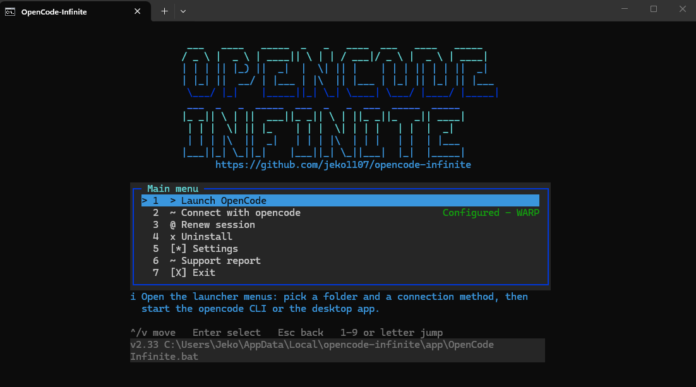
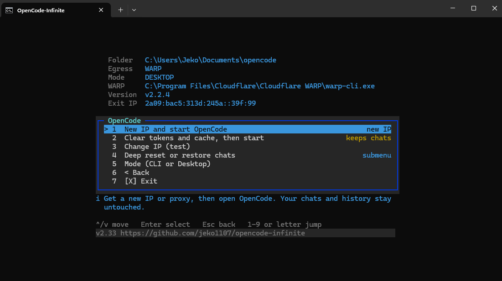
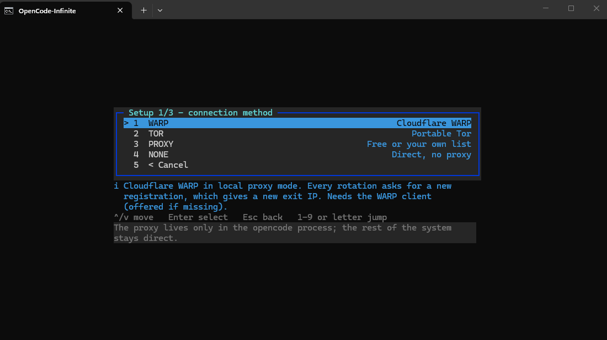
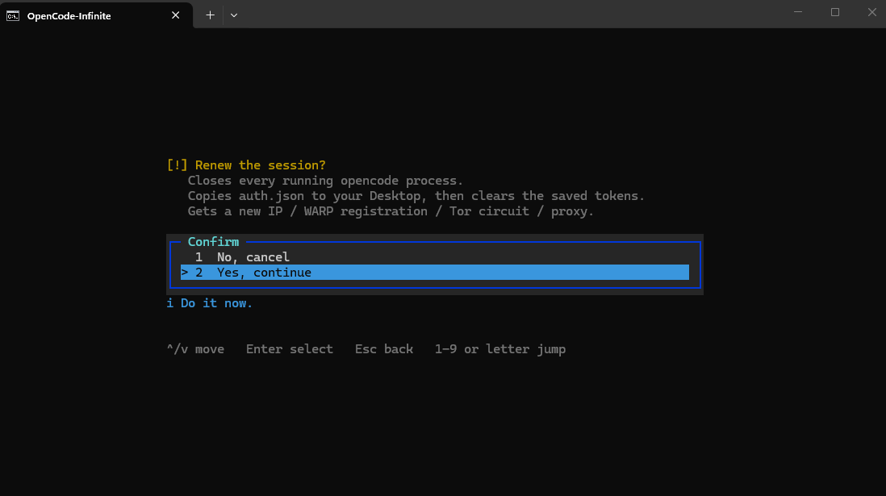
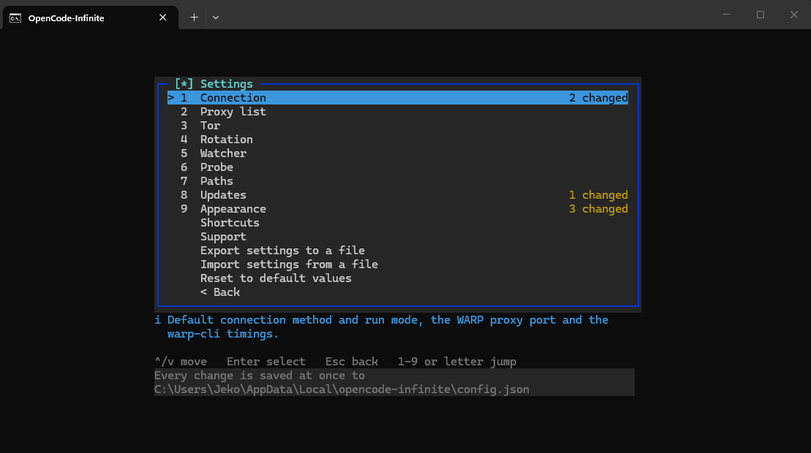

# OpenCode Infinite

A launcher for [OpenCode](https://opencode.ai). It starts OpenCode through a
different exit IP. When a free-tier limit stops your chat, it gets a new IP and
resumes the same chat.

Two versions, same flow:

| Platform | File | Status |
|---|---|---|
| Windows 10 / 11 (x64, ARM64, x86 limited) | `OpenCode Infinite.bat` | Full: WARP, Tor (portable), WireGuard (through wireproxy), VPN Gate (OpenVPN), proxies, IP hunt, deep reset, updates, 7 languages |
| Linux (bash; tested on Ubuntu 24.04 with apt, command paths checked for dnf, pacman and zypper) | `opencode-infinite.sh` | Full except the desktop app and the Windows-only items. See [Linux: what is different](#linux-what-is-different) |
| Windows 10 / 11 (x64), native app | `OpenCode Infinite.exe` | New, 3.2.0: WARP, Tor, proxies and direct connection; retries OpenCode after a crash; 7 languages. No WireGuard or VPN Gate yet. See [section 14](#14-c-app-opencode-infiniteexe). |

The sections marked **Windows only** below are not on Linux.

- **Windows:** one file, no installer, no services. Admin (UAC) for the optional WARP install and for VPN Gate (OpenVPN: one prompt on start, switch and stop). WireGuard never asks for administrator.
- **Linux:** one script. No root needed for the launcher itself. WARP and Tor need their packages installed (section 1b).

## Status (v2.47 in the repo, not released yet; v2.46 is the latest release, 2026-11-01)

**Windows (`OpenCode Infinite.bat`):** v2.47 is in the repo but not released, and it has not been run end to end. It changes: a rate limit asks before rotating (a usage limit still rotates, with a cap of 5 in 30 minutes); the Desktop app is searched again on request and can be set by hand; only the processes the launcher started are stopped; a single-instance lock; at most 3 automatic restarts in 10 minutes; "Clear cache" no longer deletes tokens, and tokens are copied before they are deleted. v2.46 is the latest release. The same release ships `OpenCode Infinite.exe` (the C++ app) and `opencode-infinite.sh`; the launcher offers to replace an `.exe` that sits next to it (section 11). v2.45 fixes the watcher closing the window with "3 was unexpected at this time." after a fatal error when the chat was resumed (the rotation now starts with a defined quota counter), and logs the fatal line that triggered the rotation. v2.44 fixed the repeated "Review" lines on the rainbow theme in short windows. v2.43 keeps the tokens across restarts, retries a crashed OpenCode on the same IP (stops after 3 crashes in 10 minutes), and searches for the Desktop app again on request. Updates now come only from GitLab releases, checked with SHA-256 (section 11). Checked on a real Windows 11 PC:

**Windows C++ app (`OpenCode Infinite.exe`, 3.2.0):** in the repo, not in a release yet (the v2.46 release has 3.1.1). It builds with Visual Studio (section 14). It has not been run against a real OpenCode install yet.

- **WARP:** `warp-cli` exit codes are read correctly. The real `warp-cli` returns 0 for `status` and `settings`. A failing command returns its code and writes the daemon's message to `wcli.log`. If a WARP step fails (protocol, mode, port or connect), the launcher stops there and reports it. It does **not** fall back to WireGuard.
- **VPN Gate:** connects with OpenVPN to real servers. OpenCode's IPv4 traffic leaves through the tunnel, the rest of the PC stays direct, and the routes are removed on stop. The OpenVPN log is read while the tunnel runs, and when OpenCode's IPs leave the routes the status shows DOWN and the launcher reconnects.
- **WireGuard:** wireproxy starts and listens. A real WireGuard server has **not** been tested yet.
- **Menus:** the UI self-test passes (65 checks). The newest menu changes (Back in the folder menu, the connection picker with WireGuard and VPN Gate, lists in Settings) are **not** tested in a console yet.
- **v2.40 fixes (2026-11-01)** (each marked `REM v2.40:` or `# v2.40` in the file):
  - **Security:** VPN Gate configs lose the directives that run programs or touch local files (`script-security`, `up`, `down`, `plugin`, `*-verify`, `management`...) before OpenVPN runs as administrator. VPN Gate also blocks IPv6 in the tunnel and routes OpenCode's IPv6 addresses into it. In WIREGUARD mode the OpenCode service is now restarted behind the proxy after a switch. The `auth.json` backup goes to `%LOCALAPPDATA%\opencode-infinite\backup\auth\`, not to the Desktop (which may sync to OneDrive). Portable Tor is checked against the official SHA-256 list.
  - **Stability:** the IP probe and the chat lookup have a time limit. An old copy no longer overwrites the official copy while another window runs it. `watch_stop` checks the start time before it kills a PID. The window stays open after a double click. The Tor wait counts real time.
  - **Behaviour:** a hunt makes 5 attempts by default (was 1). A resent message keeps `& | < > ^ % \`. Desktop mode starts without the CLI. Your own `NO_PROXY` is kept. The user PATH keeps its `%VAR%` entries. The console code page is restored. Other small fixes are listed in the file.
  - **Not tested on a real run:** the VPN Gate IPv6 block (needs OpenVPN), a real double click from Explorer, and Desktop mode without the CLI. The other fixes were tested with small test scripts, not with a full launcher run.

**Known open items:**

- **C++ app:** not tested with a real OpenCode install. It shares its state folder and `config.json` with the `.bat` (section 14).
- **Automatic update:** some users report that the update is available but the file cannot be found. Not reproduced yet. Workaround in section 13.
- **Not implemented yet:** an automatic provider switch when the free limit is reached; sessions nested under their parent chat; a folder browser that opens older versions of a project.
- **Translations:** the newest texts were written without review by a native speaker.


---

## Contents

1. [Install](#1-install)
   - [1a. Windows](#1a-windows)
   - [1b. Linux](#1b-linux)
2. [First run](#2-first-run)
3. [Menus](#3-menus)
4. [Connection modes](#4-connection-modes)
5. [Automatic IP hunt](#5-automatic-ip-hunt)
6. [Renew session](#6-renew-session)
7. [Deep reset and restore](#7-deep-reset-and-restore)
8. [Settings](#8-settings)
9. [Languages](#9-languages)
10. [Keys and commands](#10-keys-and-commands)
11. [Updates](#11-updates)
12. [Files and folders](#12-files-and-folders)
13. [Troubleshooting](#13-troubleshooting)
14. [C++ app (OpenCode Infinite.exe)](#14-c-app-opencode-infiniteexe)

- [Linux: what is different](#linux-what-is-different)

---

## 1. Install

### 1a. Windows

The Desktop folder is asked from Windows, so it works when Desktop lives in OneDrive.

**PowerShell or Windows Terminal (recommended):**

```powershell
[Net.ServicePointManager]::SecurityProtocol='Tls12'; $d=[Environment]::GetFolderPath('Desktop'); iwr https://gitlab.com/jekooo/opencode-infinite/-/releases/permalink/latest/downloads/OpenCode-Infinite.bat -UseBasicParsing -OutFile "$d\OpenCode Infinite.bat"; & "$d\OpenCode Infinite.bat"
```

**cmd** (`curl.exe` ships with Windows 10 1803 and later):

```cmd
powershell -NoProfile -Command "$d=[Environment]::GetFolderPath('Desktop'); [Net.ServicePointManager]::SecurityProtocol='Tls12'; iwr https://gitlab.com/jekooo/opencode-infinite/-/releases/permalink/latest/downloads/OpenCode-Infinite.bat -UseBasicParsing -OutFile (Join-Path $d 'OpenCode Infinite.bat'); & (Join-Path $d 'OpenCode Infinite.bat')"
```

To update an old copy, run `Update launcher.bat` from this repository in the same folder. It downloads the latest release and replaces the old file.

### 1b. Linux

Download the script into your home folder and run it:

```bash
mkdir -p ~/.local/share/opencode-infinite && curl -fsSL https://gitlab.com/jekooo/opencode-infinite/-/releases/permalink/latest/downloads/opencode-infinite.sh -o ~/.local/share/opencode-infinite/opencode-infinite.sh && bash ~/.local/share/opencode-infinite/opencode-infinite.sh
```

The launcher installs what is missing by itself on first start. Each step runs on its own, so one failure does not stop the others. The only possible prompt is sudo's password, and only when you are not root. Output goes to `~/.config/opencode-infinite/install.log`. The table shows what gets installed:

| Needed for | apt (Debian, Ubuntu) | dnf (Fedora, RHEL) | pacman (Arch) | zypper (openSUSE) |
|---|---|---|---|---|
| WARP mode | Cloudflare's apt repo, then `cloudflare-warp` | Cloudflare's `.repo` file, then `cloudflare-warp` | Not in the official repos. Install `cloudflare-warp-bin` from the AUR by hand | Not automated. Install `cloudflare-warp` by hand |
| TOR mode | `tor`, `privoxy` | `tor`, `privoxy` | `tor`, `privoxy` | `tor`, `privoxy` |
| OpenCode (all modes) | `npm i -g opencode-ai` into `~/.local`. If npm is missing or fails, the official installer (`opencode.ai/install`) | same | same | same |
| Helpers | `curl`, `jq`, `nodejs`, `npm`, `xdg-user-dirs` | same names | same names | same names |

WARP's service (`warp-svc`) is enabled where systemd runs. Without systemd, start it by hand. Tor and privoxy: the launcher disables the privoxy system service it installed, so it does not block the Tor bridge on port 8118.

The script is one file. It copies itself into `~/.config/opencode-infinite/app/` at
setup, and the commands it creates run that copy.

---

## 2. First run

**Windows**

1. Double-click `OpenCode Infinite.bat`.
2. Pick a language (section 9). `Automatic` follows Windows.
3. Choose **Connect with opencode** on the home screen. It asks for a connection method (section 4: WARP, TOR, PROXY, NONE, and on Windows also WIREGUARD and VPNGATE) and a run mode, then creates the `opencode` command and the shortcuts (section 10).
4. Choose **Launch OpenCode**, pick a folder and a connection, and start.

If WARP, Tor or OpenCode is missing, the launcher offers to install it. Nothing is installed without asking, and UAC is shown to you.



**Linux**

1. Run the script (section 1b).
2. Choose **Connect with opencode** and pick WARP, TOR, PROXY or NONE. Setup creates the `opencode`, `opencodeinf` and `opencodeoc` commands in `~/.local/bin`, and adds that folder to your `PATH` in `~/.bashrc` if needed.
3. Open a new terminal, then run `opencode` inside a project folder.

The screens and keys are the same as on Windows. Colors and the box drawing depend on your terminal.

---

## 3. Menus

### Home screen

| Option | What it does |
|---|---|
| Launch OpenCode | Picks a folder and a connection, then starts the CLI or the desktop app *(desktop app: Windows only)* |
| Connect with opencode | Guided setup. Creates the `opencode` command and the shortcuts. Shows `Configured` when done |
| Renew session | Closes OpenCode, backs up `auth.json` (section 6), clears the saved tokens and gets a new IP (section 6) |
| Uninstall | Removes only what setup added and restores the settings it changed. Asks first |
| Settings | Every launcher option (section 8) |
| Support report | Writes one text file with versions, settings and the recent log, for help. Passwords and tokens are removed. IPs are masked by default |
| Exit | Closes the launcher |

### Main menu

Opened after **Launch OpenCode**. It shows the folder, egress, mode, WARP version and exit IP.

| Key | Option | What it does |
|---|---|---|
| `1` | New IP and start OpenCode | Gets a new IP or proxy, then opens OpenCode. Chats stay as they are |
| `2` | Continue | Same IP and chat: opens OpenCode as it was. Saved tokens are kept |
| `3` | Change IP (test) | Rotates the connection only, without opening OpenCode |
| `4` | Deep reset or restore chats | Submenu (section 7) |
| `5` | Mode (CLI or Desktop) | Switches between the terminal and the desktop app *(Windows only)* |
| `6` | Back | Returns to the home screen |
| `7` | Exit | Closes the launcher |

On Linux the main menu has these items: New IP and start OpenCode, Start OpenCode, Change IP (test), Chats (deep reset and restore), and Back.



---

## 4. Connection modes

The egress default is set during setup and in Settings, Connection (`OC_EGRESS_DEFAULT`). With `ASK` the launcher asks at each start; the choice is not saved.

| Mode | How it works |
|---|---|
| **WARP** | Cloudflare WARP in local proxy mode (MASQUE protocol, port 40000). Every rotation registers again, which gives a new exit IP. Offered when WARP is missing. If a step fails, WARP stops there; there is no WireGuard fallback |
| **TOR** | Tor with an HTTP bridge on `127.0.0.1:8118`. **Windows:** a portable Tor with a built-in bridge, no Privoxy needed. **Linux:** `tor` and `privoxy` from your system. A Tor that is already running (Tor Browser on port 9150, or 9050) is used as it is and never closed by the launcher |
| **PROXY** | Free HTTP proxies from a list (default: ProxyScrape). Dead ones are skipped. Use your own list with `PROXY_LIST_URL`: a URL or a local file. In PROXY mode, after `PROXY_ROT_MAX` burned proxies the launcher asks whether to switch the hunt to Tor |
| **NONE** | Direct connection, no proxy |
| **WIREGUARD** | **Windows only.** Your WireGuard `.conf` files from `WG_DIR` (default `...\opencode-infinite\wireguard`), run through [wireproxy](https://github.com/windtf/wireproxy), a local proxy that only OpenCode uses. Each switch takes the next file. Needs no WireGuard install and no administrator prompt |
| **VPNGATE** | **Windows only.** Public servers from [vpngate.net](https://www.vpngate.net) through the normal OpenVPN client (`openvpn.exe`). Installed with winget when it is missing. OpenVPN creates a system tunnel, but the launcher adds routes only for the IPs of `opencode.ai`, `models.opencode.ai` and `opentunnel.xyz` as they resolve on your PC at start (`route-nopull`). Everything else stays direct. Filter by `VPNGATE_COUNTRY`, `VPNGATE_MAX` servers tried per start. A server that fails is skipped for the session |

The proxy applies only to the OpenCode process. Your browser and other apps
stay direct. WIREGUARD makes no system tunnel. VPNGATE adds routes to the system
table for OpenCode's IPs only, so any other program that talks to those same IPs also uses the tunnel.
VPN Gate servers carry IPv4 only. The launcher also routes OpenCode's IPv6 addresses into the tunnel, where OpenVPN's `block-ipv6` drops them, so OpenCode falls back to IPv4 through the tunnel and never sends IPv6 outside it. OpenCode's Node processes also start with IPv4 first. Other programs' IPv6 traffic is not changed. The IPv6 block is not tested with a real server yet. The server configs are filtered before use: directives that run programs or touch local files are removed.

WIREGUARD was tested only with fake tools and a local proxy: a real WireGuard server and the proxy path through it are not verified yet. VPNGATE was tested with the real OpenVPN client and real vpngate.net servers: the tunnel came up, OpenCode's IPv4 requests left through it, other traffic stayed direct, and the routes were removed on stop. Not verified yet: the winget install on a clean PC, and the UAC prompts on machines other than the test one. The routes are set when the tunnel starts. If OpenCode's IPs change during a session, the status shows DOWN and the launcher reconnects, which may pick another server. The exit IP check goes through opencode.ai, so a request that leaves by the normal route is reported as a failure. Report problems in an issue.



**Run mode** is chosen the same way: **CLI** (terminal), **Desktop** (the OpenCode app), or **Ask every time**. Linux runs the CLI only.


**32-bit Windows (x86):** WARP and the desktop app are not available. OpenCode runs
through npm with a 32-bit Node.js.

---

## 5. Automatic IP hunt

When a chat hits a limit, the launcher hunts for a new IP.

- **Target:** `TARGET_COUNTRY` (for example `DE`) and/or `TARGET_PREFIX` (for example `104.28.`). Both empty means any new IP.
- **Caps:** `TARGET_TRIES` attempts, `TARGET_MINUTES` minutes, and `TARGET_INTERVAL` seconds between attempts. The hunt is the same on both systems.
- Each attempt prints its number, the IP, the country and whether it matches. The hunt ends with a summary: target reached, or which cap stopped it.
- `Esc` or `Q` during the wait stops the hunt and returns to the menu.
- With `AUTO_ROTATE` off, the menu decides. The `R` key at the closed prompt always rotates.

---

## 6. Renew session

Use **Renew session** when the free limit is reached or the login has expired. It:

1. closes every running OpenCode process;
2. backs up `auth.json` to `%LOCALAPPDATA%\opencode-infinite\backup\auth\<date-time>\`;
3. clears the saved tokens;
4. gets a new IP, WARP registration, Tor circuit or proxy.

Between renewals the launcher keeps a copy of `auth.json` in its state folder (`auth_snapshot`) and puts it back at the next start if the file has disappeared. A reset removes that copy, so the tokens stay gone. Side effect: if you log out inside OpenCode, the old login comes back at the next start; use Renew session to be sure the tokens are cleared.

The backup stays out of the Desktop because the Desktop often syncs to OneDrive, and `auth.json` holds your API keys in plain text. On Linux, step 2 still uses your Desktop folder if it exists, and your home folder otherwise.



---

## 7. Deep reset and restore

Option `4` in the main menu opens this submenu. It is the only option that moves your chats, and it asks first.

**Deep reset**

1. Stops OpenCode.
2. Moves the database (`opencode.db` with its `-wal` and `-shm` files) and the `storage` folder to `Desktop\opencode_chats_archiviate\<date-time>\`. Each reset gets its own folder. Nothing is deleted.
3. Clears tokens and the cache.
4. Starts a fresh session.

**Restore chats** lists the archived folders, newest first. Pick one and the launcher:

1. stops OpenCode;
2. moves the chats in place now to `Desktop\opencode_chats_before_restore\<random>\`;
3. copies the database and storage back from the chosen folder;
4. starts OpenCode.

Login tokens are not restored. Sign in again if OpenCode asks.

---

## 8. Settings

Open **Settings** from the home screen. Every change is saved at once to
`config.json` on Windows, or to `config.env` on Linux (section 12). The `.bat` and the C++ app share `config.json`; on Linux it is updated too when it exists (section 14).



Settings are grouped as **Connection, Tor, Proxy list, Rotation, Watcher, Probe, Updates, Appearance, Shortcuts, Logs** on both systems, and **Support** (export, import, reset, shortcut, updates, report). Windows also has **Egress** (WireGuard and VPN Gate). Enter toggles a yes/no value, opens a list for a choice (the current value is marked), and opens a prompt for a number or text.

Setting names are the same on Windows (`config.json`) and Linux (`config.env`). The defaults:

| Setting | Default | Meaning | Platform |
|---|---|---|---|
| `OC_EGRESS_DEFAULT` | `ASK` | Route for OpenCode: `ASK` (picked at each start), `WARP`, `TOR`, `PROXY` or `NONE` | both |
| `PROXY_PORT` | `40000` | WARP local proxy port | both |
| `WARP_WAIT` | `20` | Seconds to wait for WARP to connect (Windows: `6`) | both |
| `WARP_CALL_TIMEOUT` | `15` | Seconds one `warp-cli` call may take | both |
| `TOR_SOCKS_PORT` / `TOR_HTTP_PORT` | `9050` / `8118` | Tor SOCKS port and the HTTP bridge port | both |
| `TOR_AUTO_INSTALL` | `1` | Install Tor when missing (Windows: portable bundle; Linux: package manager) | both |
| `TOR_BOOTSTRAP_WAIT` | `120` | Seconds to wait for Tor to connect | both |
| `PROXY_LIST_URL` | ProxyScrape free HTTP list | Your proxy list: a URL or a local file, any format. `ip:port` entries are picked out | both |
| `PROXY_LIST_MIN_BYTES` | `20` | A downloaded list smaller than this is rejected (`0` = off) | both |
| `PROXY_TRY_MAX` | `25` | Proxies tested per pick | both |
| `PROXY_PROBE_TIMEOUT` | `8` | Seconds one proxy test may take | both |
| `PROXY_ROT_MAX` | `10` | Burned proxies in one hunt before PROXY mode offers Tor | both |
| `PROXY_API_CHECK` / `PROXY_API_CHECK_URL` | `0` / `https://api.opencode.ai/` | Also require the proxy to reach the OpenCode API host | both |
| `AUTO_ROTATE` | `1` | Rotate and resume after a limit by itself (`0` = the menu decides) | both |
| `ROTATE_TRIES_MAX` | `4` | Rotation attempts when the route is not up (1-20) | both |
| `ROTATE_COOLDOWN` | `10` | Seconds between rotation attempts | both |
| `IP_FIND_MAX` | `0` | Burned IPs a hunt may reject (`0` = no limit) | both |
| `TARGET_COUNTRY` / `TARGET_PREFIX` | empty | Country (e.g. `DE`) and IP start (e.g. `104.28.`) to hunt for | both |
| `TARGET_TRIES` / `TARGET_MINUTES` / `TARGET_INTERVAL` | `5` / `15` / `15` | Attempts, minutes and seconds between attempts of one hunt | both |
| `ON_CLOSE` | `ask` | After OpenCode closes: `ask` (R new IP and resume, M menu, Q quit) or `quit` | both |
| `WATCH` | `1` | Watch the OpenCode log for limit errors | both |
| `RESUME_MSG` | `continue` | Message sent when a chat is resumed | both |
| `RESUME_AUTO` | `1` | The resume approves tool permissions (`opencode run --auto`) | both |
| `RESUME_TIMEOUT` | `90` | Seconds before a stuck resume is stopped and the launcher rotates | both |
| `PROBE` / `PROBE_MODEL` | `1` / `opencode/big-pickle` | Probe each new IP with one cheap message, and the model it uses | both |
| `PROBE_BROKEN_MAX` | `3` | Non-limit probe failures before the hunt stops | both |
| `UPDATE_CHECK` | `1` | Check for a newer launcher at start (section 11) | both |
| `UPDATE_ASK` | `ask` | `ask` offers updates at start, `never` turns checks off | both |
| `OC_API_BASE` | `https://opencode.ai/update/api/latest` | Where the newest OpenCode version is read from (Linux: npm is the fallback) | both |
| `OCUI_THEME` | `ocean` | Colors: `ocean`, `forest`, `sunset`, `mono`, `rainbow` | both |
| `OCUI_COLOR` | `auto` | `auto` follows the terminal and `NO_COLOR`; `on` or `off` forces it | both |
| `OCUI_ICONS` | `auto` | Borders: `auto`, `unicode`, `emoji` (same as unicode on Linux), `ascii` | both |
| `OCUI_LANG` | `auto` | Language (section 9) | both |
| `KEY_ROTATE` / `KEY_MENU` / `KEY_QUIT` | `R` / `M` / `Q` | Letter keys for the closed-OpenCode prompt | both |
| `LOG_ENABLED` / `LOG_MAX_KB` | `1` / `1024` | Launcher log on or off, and its size limit | both |
| `LOG_MASK_IP` | `1` | Mask public IPs in the support report | both |
| `OC_MODE_DEFAULT`, `OC_APP` | | CLI or Desktop run mode, path of the Desktop app | Windows only |
| `WG_DIR` | empty | Folder of WireGuard `.conf` files (empty = `...\opencode-infinite\wireguard`) | Windows only |
| `VPN_TIMEOUT` | `45` | Seconds one WireGuard or VPN Gate connection may take to answer | Windows only |
| `VPNGATE_COUNTRY` / `VPNGATE_MAX` | empty / `8` | VPN Gate country (two letters, empty = any) and servers tried per start | Windows only |
| `MENU_DEFAULT` | `ask` | Option that runs at once when the menu would show: `ask`, `1` (new IP), `2` (continue, tokens kept) or `3` (change IP) | Windows only |
| `MULTI_INSTANCE` | `0` | `1` lets a second launcher window run with its own copy of the settings (in `instances\<id>`) | Windows only |
| `REUSE_EMPTY` | `1` | Continue the empty chat of the folder instead of creating another | Windows only |
| `CHAT_SNAPSHOT` | `1` | Print the last messages of the chat when OpenCode closes for a renewal | Windows only |
| `TYPE_AHEAD` | `1` | Text typed during a renewal is sent as the first message of the resume | Windows only |
| `RESUME_MODE` / `RESUME_TEXT` | `continue` / empty | What the resume sends: `continue`, `last` (your last message again) or `custom` (`RESUME_TEXT`) | Windows only |
| `OC_MODEL` | empty | Model for the resume (`-m`), for example `opencode/deepseek-v4.1-flash-free` | Windows only |
| `LIMIT_ROT_MAX` / `LIMIT_ACTION` / `LIMIT_MODEL` | `3` / `rotate` / empty | Limits in a row before the launcher stops. Then `rotate` (new IP), `provider` (switch to `LIMIT_MODEL` once) or `ask` | Windows only |
| `WHERE_TIMEOUT` | `5` | Seconds a Windows `where` lookup may take | Windows only |
| `OCUI_FONT` / `OCUI_FONT_SIZE` | empty / `16` | Terminal font and size (Windows console) | Windows only |

---

## 9. Languages

Pick the language in **Settings, Appearance, Language**. The list has
`Automatic` (follows Windows), English, Español, Français, Deutsch, Português,
Italiano and Türkçe.


Each language is a JSON file in the `langs` folder of this repository. The
launcher downloads only the language you pick, when you pick it. It stays in
`%LOCALAPPDATA%\opencode-infinite\lang\` and is not downloaded again until you pick
it again. Without a connection the menus stay in English until a download works.
Logs and the support report stay in English.

On Linux the same languages are used. The file goes to `~/.config/opencode-infinite/langs/`,
and `Automatic` follows `LANG`.

---

## 10. Keys and commands

| Key | Action |
|---|---|
| Arrows | Move through a menu |
| `Enter` | Select |
| `Esc` | Back, in every menu and prompt |
| `1`-`9` | Select a numbered option directly |
| `Ctrl+C` | Quit the launcher. **Windows:** it stops the processes it started and leaves the window open. **Linux:** it quits the launcher |
| `R`, `M`, `Q` | At the closed-OpenCode prompt: new IP and resume, menu, quit. The letters are editable in Settings, Shortcuts |

The commands created by **Connect with opencode** work in any terminal:

| Command | What it does |
|---|---|
| `opencode` | Starts OpenCode through the saved connection |
| `opencodeinf` | Opens the launcher menu |
| `opencodeoc` | Starts the OpenCode you had before the launcher, with no connection. Use it when the launcher breaks |

**Windows:** to start the launcher in a folder, drag the folder onto the `.bat`, or run
`OpenCode Infinite.bat "D:\work\project"`. UNC paths work too.
`OpenCode Infinite.bat --run` does a quick start with the saved connection.

**Linux:** `opencode` with no arguments starts OpenCode in the current folder through
the saved connection. `opencodeinf` opens the menu. The script can also be run
directly: `bash opencode-infinite.sh --run`.

---

## 11. Updates

**Windows.** With `UPDATE_CHECK=1`, every start checks three things:

- **A newer launcher** in the latest [release](https://gitlab.com/jekooo/opencode-infinite/-/releases). The launcher reads the release tag, downloads the file and `SHA256SUMS` at that tag, and keeps the file only when its SHA-256 matches and its header carries the tag's version. It never takes a file from `main` that has no release. It asks `[Y/N]`. On `Y`, it keeps a backup of the current file, replaces it and restarts. A failed checksum is shown and nothing changes.
- **The same release's `OpenCode Infinite.exe`** (the C++ app). When an `OpenCode Infinite.exe` sits next to the launcher, it is checked against its line in the same `SHA256SUMS` and downloaded only when the SHA-256 matches. It asks `[Y/N]` before replacing it. The Linux script takes its own line from the same file.
- **A newer OpenCode** from opencode.ai (official release data, SHA-256 checked). It asks `[Y/N]`, closes every OpenCode process, then installs. It uses the same channel as the running command: npm or the standalone build.
- **A newer OpenCode Desktop** (Desktop mode only). Same flow, with the silent installer.

No network, or an unreadable version, changes nothing.

**Linux.** On start the launcher checks the latest release for a newer copy of itself, with the same SHA-256 check (it backs up the old file and asks first) and for a newer OpenCode through npm (it asks first). **Check for updates** in Settings > Support runs the same check now.

`Update launcher.bat` uses the same source and the same check. It is kept in the repository and is not attached to the releases; it still fetches the launcher from the latest release.

**Publishing a version** (maintainers):

1. Raise the version in the launcher header (`REM  OpenCode launcher  (vX.Y)`) and, for Linux, `VERSION=` in the script.
2. Write the checksums and commit them with the files: `sha256sum "OpenCode Infinite.bat" opencode-infinite.sh > SHA256SUMS`. The `.exe` is built from `C++/` and is not committed; add its line for `OpenCode Infinite.exe` by hand (`sha256sum` of the built file), from a copy kept next to the other files.
3. Push a tag with the same version: `git tag vX.Y && git push origin main vX.Y`
4. Create the release for that tag in GitLab (**Deploy > Releases > New release**) and attach `OpenCode Infinite.bat`, `opencode-infinite.sh`, `SHA256SUMS` and the built `.exe` as `OpenCode-Infinite.exe` (the launcher downloads it from that path). `Update launcher.bat` is not attached.

The launcher only reads the latest release's tag and checks the file against `SHA256SUMS` at that tag, so a commit on `main` without a release reaches nobody. `.gitattributes` keeps the `.bat` files with CRLF in the repository, so the downloaded bytes are the ones that were hashed.

---

## 12. Files and folders

**Windows**

| Path | Purpose |
|---|---|
| `%USERPROFILE%\.local\share\opencode\` | OpenCode data: chats and database. Owned by OpenCode |
| `%LOCALAPPDATA%\opencode-infinite\` | Launcher state folder |
| `...\opencode-infinite\app\` | The launcher copy that the `opencode` commands run |
| `...\opencode-infinite\config.json` | Your settings |
| `...\opencode-infinite\lang\` | Language files you picked, and `messages.txt` for the batch messages |
| `...\opencode-infinite\launcher.log` | Launcher log |
| `...\opencode-infinite\reports\` | Support reports |
| `...\opencode-infinite\tor\` | Portable Tor (TOR mode only) |
| `...\opencode-infinite\backup\auth\` | `auth.json` backups made by Renew session and the resets |
| `Desktop\opencode_chats_archiviate\` | Chats archived by a deep reset |
| `Desktop\opencode_chats_before_restore\` | Chats moved aside by a restore |

The C++ app uses this same folder and `config.json`, unless `OCIN_STATE` points to another folder (section 14).

**Linux**

| Path | Purpose |
|---|---|
| `~/.local/share/opencode/` | OpenCode data: chats, database and `auth.json`. Owned by OpenCode |
| `~/.config/opencode-infinite/` | Launcher state folder (`OCI_STATE` overrides it) |
| `~/.config/opencode-infinite/config.env` | Your settings, one `KEY=value` per line |
| `~/.config/opencode-infinite/app/` | The launcher copy that the commands run |
| `~/.config/opencode-infinite/launcher.log` | Launcher log |
| `~/.config/opencode-infinite/reports/` | Support reports |
| `~/.config/opencode-infinite/tor/`, `tor.log`, `privoxy.conf` | Tor data and the HTTP bridge config (TOR mode only) |
| `~/.config/opencode-infinite/wcli.log` | `warp-cli` output, for WARP problems |
| `~/.local/bin/opencode`, `opencodeinf`, `opencodeoc` | The commands created by setup |

---

## 13. Troubleshooting

| Symptom | What to do |
|---|---|
| The launcher shows old text or an old version | **Windows:** run `Update launcher.bat`, or accept the update prompt on the next start. **Linux:** download the script again (section 1b) |
| `Terminate batch job (Y/N)?` | *Windows.* You pressed `Ctrl+C` inside the launcher. Answer `N` to keep it running |
| WARP rotation keeps failing | Use **Renew session**. The daemon's own error text is in `wcli.log` in the state folder |
| TOR says it is not up after 120 s | Raise `TOR_BOOTSTRAP_WAIT`. **Windows:** the last `tor.log` lines are printed with the message. **Linux:** read `~/.config/opencode-infinite/tor.log` |
| TOR is up but the IP is not Tor | **Linux:** the port on `TOR_HTTP_PORT` is served by a Privoxy that does not forward to Tor. Set another `TOR_HTTP_PORT` in `config.env`, or set `forward-socks5t / 127.0.0.1:9050 .` in your Privoxy config |
| A custom proxy list is ignored | One proxy per line, as `ip:port` or `http://ip:port`. For a short list set `PROXY_LIST_MIN_BYTES=0` (Windows) |
| `Another OpenCode launcher seems to be running` | *Windows.* A lock is left over from a `Ctrl+C`. `Y` is safe |
| `opencode is not set up` on Linux | Run **Connect with opencode** first. The launcher reads the real OpenCode path from `config.env` |
| `opencode was not found` on Linux | Install it: `npm i -g opencode-ai`, then run Connect again |
| OpenCode does not open | Run `opencodeoc` to reach OpenCode, then create a support report from the home screen |
| The update says a new version is available, but the file cannot be found | Known issue, not reproduced yet. Run the install command in section 1a: it puts a fresh copy on the Desktop. Then create a support report and attach it to an issue |
| The font does not change | *Windows.* Reopen the tab. Windows Terminal keeps its font in its own `settings.json`. VS Code keeps it in `terminal.integrated.fontFamily` |

For anything else, create a **Support report** from the home screen and attach
the file to an issue.

---

## 14. C++ app (OpenCode Infinite.exe)

A native Windows app with the same job as the `.bat`: a new exit IP, then OpenCode. It is one `.exe`. Its languages are downloaded from the repository into the state folder, as the `.bat` does.

**Get it.** Download `OpenCode-Infinite.exe` from the [latest release](https://gitlab.com/jekooo/opencode-infinite/-/releases/permalink/latest). Rename it `OpenCode Infinite.exe` if you want the `.bat` updater to find it (section 11). A language is downloaded the first time it is chosen, or at start if it is missing; without a copy and without a connection the app runs in English.

**Screens.** Home (New IP and start OpenCode, Connect with opencode, and the other pages), Settings, Chats, Renew session, Support and Uninstall. The log panel shows the time as HH:MM:SS.

**Connection.** WARP, Tor, proxy and NONE, with the same meaning as in section 4.

**Crash retry (`CRASH_RETRY`, on by default).** If OpenCode exits with an error code, the app restarts it on the same exit IP after 2 s, then after 4 s. A third crash within 10 minutes stops it. Ctrl+C (code 0xC000013A) is not counted as a crash. Caveat: an error exit code on a normal close of the desktop app also counts as a crash. Set `CRASH_RETRY` to 0 to turn this off.

**Tokens.** The app keeps a copy of `auth.json` in `auth_snapshot` inside the state folder. If OpenCode deletes `auth.json` while it runs, the app restores it from that copy. Renew session and deep reset remove the copy on purpose.

**Not in the C++ app yet.** WireGuard, VPN Gate, the automatic chat resume after a rotation (`RESUME_MODE`), and the other options that only the `.bat` has. Use the `.bat` for those.

**Updates.** The app does not replace itself. The setting "Launcher release URL" is empty by default, so no check is made. If you set it to a JSON file with `version` and `url`, the app only reports a newer version in the log. To update, download the new `.exe` from the release. The `.bat` updater replaces an `OpenCode Infinite.exe` that sits next to it (section 11).

**State folder.** The same as the `.bat`: `%LOCALAPPDATA%\opencode-infinite\`, with `config.json` (the `.bat`'s layout: `settings`, `setup`, `font`; only values that differ from the default are written) and `config.env`. Both apps read and write the same `config.json` and keep the keys the other one knows. Languages go to its `lang\` folder. Set `OCIN_STATE` to a folder of your own if you want a separate copy.

**Linux and WSL.** The `.sh` reads `config.env`. When `config.json` exists it also updates it (needs `python3`), so a change made in the `.sh` reaches the `.bat` and the app. To share the Windows folder from WSL, set `OCI_STATE=/mnt/c/Users/<you>/AppData/Local/opencode-infinite` before starting the `.sh`.

**Build.** Windows 10 or 11 (x64) with Visual Studio and the "Desktop development with C++" workload. The project uses toolset v145. Open `C++\OpenCodeInfinite.sln`, choose Release and x64, and build. The result is `C++\bin\Release\OpenCodeInfinite.exe`. From a developer prompt: `MSBuild "C++\OpenCodeInfinite.vcxproj" /p:Configuration=Release /p:Platform=x64`. Dear ImGui is in `C++/third_party`.

## Linux: what is different

- **Same:** the menus and keys, the four egress modes, rotation, the IP hunt, the
  probe, the watcher that stops OpenCode at a limit line and resumes the chat, Renew
  session, deep reset and restore, Settings, the update check, the shortcut file
  (`.desktop`), the languages, the support report, and the three commands.
- **Not on Linux:** the desktop app and run mode (Linux runs the CLI), the portable
  Tor bundle (Linux uses your `tor` and `privoxy`), the `OC_APP` path, the `where`
  lookup timeout, and the terminal font settings (the terminal owns its font).
- **Different:** the launcher installs WARP, Tor, privoxy and opencode with your
  package manager (apt, dnf, pacman or zypper). On pacman, WARP is an AUR package
  and is installed by hand.
- **Rotation in TOR mode:** the launcher restarts only the Tor it started. If you
  use a Tor that is already running, the IP may not change between tries.
- **Terminal:** colors and box drawing need a UTF-8 locale with 256 or true color.
  `NO_COLOR=1` turns the colors off.

---

**jeko1107** - https://gitlab.com/jekooo/opencode-infinite
